# Implementation design

NestedSet has one shared relational hierarchy engine and four native provider
integrations. Six packages express these dependencies. The common EF package
extends an application's existing model and `DbContext`; it does not introduce
a second unit of work or a domain container entity.

## Package boundaries

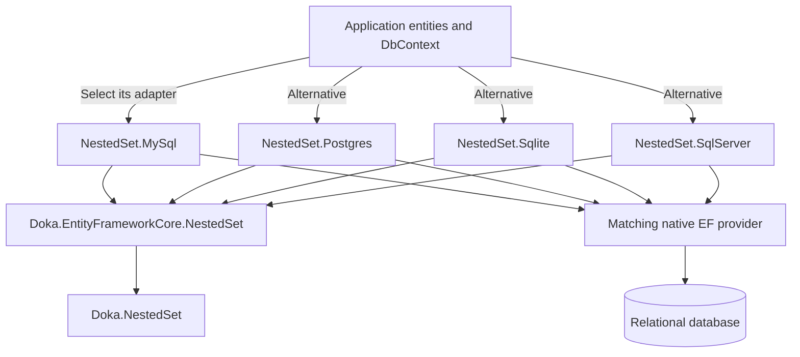

`Doka.NestedSet` contains optional entity contracts, bounds semantics, and pure
relationship predicates. It has no EF Core dependency.

`Doka.EntityFrameworkCore.NestedSet` owns common model roles, structural query
and mutation algorithms, ordering, transaction/savepoint coordination, tree
lifecycle, validation, rebuild, and bounded diagnostics. Its shipping dependency
graph contains EF/Relational and `Doka.NestedSet`, without a concrete provider.

The `.MySql`, `.Postgres`, `.Sqlite`, and `.SqlServer` packages own their native
SQL, registry rowset transport, physical model/index conventions, query
translation, and physical strategy selection. They implement one internal
selected-provider boundary; it is not a public extension framework. Common
algorithms are not copied into the adapters. Each adapter uses the caller's
context, connection, transaction, execution strategy, and authorization decision.
Each adapter's packed kernel dependency is an exact release version because
the boundary uses internal members. Source `ProjectReference` restore edges
keep the SDK's ordinary minimum-range representation; a pack-only target pins
the generated NuGet dependency without changing local restore semantics.
The kernel uses only public `Doka.NestedSet` APIs and retains a minimum dependency.
See [D-020](decisions/D-020-provider-owned-runtime-packages.md) and the
[installation/registration migration](upgrading-provider-packages.md).

## Registration and finalized model

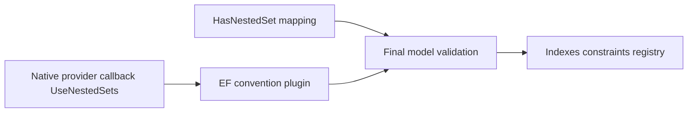

The native provider callback's `UseNestedSets()` selects the exact adapter and
installs the convention plugin, SaveChanges guard, relational persistence
boundary and stateless query-expression interceptor in the EF internal service
provider. Its immutable options identity includes the actual selected adapter,
so contexts cannot reuse an incompatible provider service graph. Missing,
conflicting, or mismatched registration is rejected before hierarchy I/O,
including when a compiled model bypasses convention execution.

The context-scoped `INestedSetProviderBinding` factory validates the completed
options, actual native provider, and exact adapter/native assembly identities.
It returns the existing immutable adapter singleton itself; no binding wrapper
or context reference is added. EF caches that validated reference in the context
scope, so warm `Resolve` calls do not repeat provider-name enumeration or options
metadata inspection. The scope owns validation, while the adapter stays
stateless across contexts.

The query interceptor uses EF's public
`IQueryExpressionInterceptor` contract and retains no context or query state.
`HasNestedSet(...)` assigns structural roles on an ordinary entity, including
a scalar NodeKey, stable TreeId, optional Scope,
Parent, bounds, Depth, Position, and optional sibling order.

Final validation rejects incomplete, type-incompatible, keyless, or
non-atomically writable mappings before the application performs a hierarchy
operation. Immutable mapping descriptors are cached by finalized model
identity. No context instance or tenant value enters that cache, so context
pooling cannot retain one lease's state.

Finalization also captures effective identity collations for each configured
hierarchy's exact structural table. These owner-specific facets survive EF's
runtime metadata trimming and compiled-model generation. A supplied or compiled
model with incomplete older capture must be regenerated with the current
NestedSet conventions; runtime does not silently replace its comparison rules.

## Runtime facade

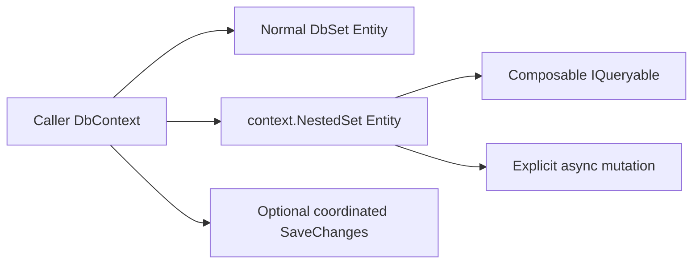

The ordinary `DbSet<TEntity>` remains the payload and tracking surface.
`context.NestedSet<TEntity>()` is a lightweight facade over the same model and
context. If Scope is configured, `ForScope(scope)` must bind it before any
query or mutation. Method arguments infer the configured NodeKey and TreeId
types and are checked against model metadata before SQL generation.

## Typed feature execution

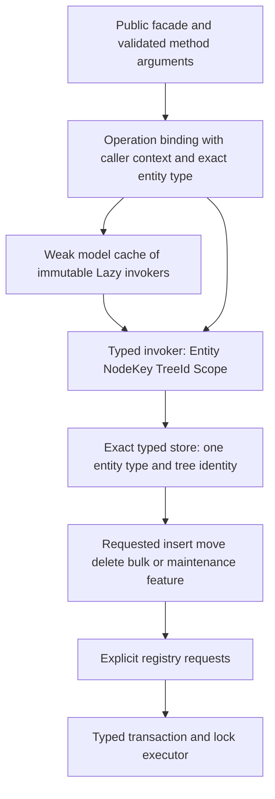

Finalized metadata determines the configured NodeKey, Scope, and TreeId CLR
types. The binding checks public arguments, then uses an immutable
`NestedSetMutationInvoker<TEntity, TKey, TTreeId, TScope>` cached by
`IEntityType`. The weak-table cache stores a `Lazy` with
`ExecutionAndPublication`: concurrent misses may allocate competing wrappers,
but generic reflection initializes the winning invoker once. Cached objects
hold no context, scoped value, transaction, or feature instance.

Four-role runtime types consistently use `<TEntity, TKey, TTreeId, TScope>`.
Generic virtual facade methods keep scalar arguments typed. Once the public
role checks succeed, the override selects the requested closed specialization's
static feature core. These cores are stateless, so dispatch needs no invoker
cast or per-operation adapter. NodeKey, TreeId, and Scope values remain typed
between facade and feature.

`ForScope(...)` allocates one private typed Scope carrier for the binding and
captures its independent value snapshot. The invoker casts that carrier's
reference to read the exact mapped Scope; the scalar remains typed. Unscoped
bindings need no carrier, and neither carrier nor bound value enters the
immutable model cache.

The invoker constructs only the requested feature and its consumed helpers.
`NestedSetStore<TEntity, TKey, TTreeId, TScope>` requires
`(context, entityType, scope, treeId)`; it has no scope-wide mode or optional
tree identity. The store captures identities through their EF comparers and
uses typed TreeId expressions in structural reads. Features share storage,
mapping, and execution primitives rather than a second forwarding service.
NodeKey arguments are captured before asynchronous discovery. Converted
mutable identities use their configured snapshot; binary identities always
receive an independent copy.

Parent is `NestedSetParent<TKey>`, an inline pair of `HasValue` and `Value`.
Presence is separate from the key's default value, so an assigned parent key
of `0` or `Guid.Empty` remains a real parent. Structural projections retain
the mapped nullable Parent property type while constructing this carrier;
querying, placement, updates, reorder planning, validation, and active insert
stages use the typed value. A cached bridge writes the mapped nullable Parent
type at the EF expression boundary. Converted custom key structs do not need
equality operators merely to participate in a mapped query. A required NodeKey
with nullable CLR storage retains its actual Parent type; the bridge does not
construct a second Nullable wrapper around it.

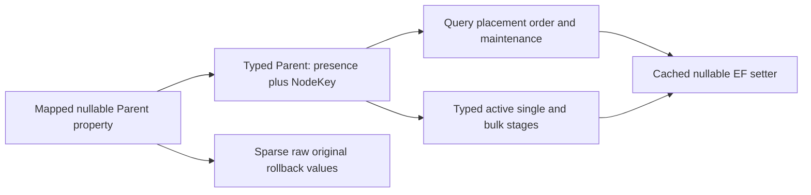

Active stages snapshot their typed identities before asynchronous work and
detect callback changes using the configured comparison contract. Sparse
`NestedSetBulkPlan.OriginalStructure` snapshots preserve the detached input's
raw null, sentinel, and non-sentinel values for rollback. They are not active
operation state. Likewise, a managed Parent change keeps its original raw
property value while its destination parent stays typed. Normalizing these
rollback values to non-null runtime identities would prevent exact restore.

`NestedSetMutationExecutor<TEntity, TKey, TTreeId, TScope>` consumes these same
types and the exact finalized entity mapping. Provider-equal tracked identities
are rejected before SQL. Remaining tracked NodeKeys are checked against the
locked trees through native predicates, then the tracker is checked
again before structural writes. This distinguishes native aliases from
application comparers that equate different stored trees.

Qualified native NodeKeys use the provider's collection parameter transport
per captured Scope group, with at most 64 requested trees in each predicate.
The SQL predicate still constrains the group's Scope. Unsupported or converted
keys use batches of at most 64 candidate keys. Grouping never separates Scope
from NodeKey, so repeated keys in different tenants cannot create false
membership. The [performance guide](performance.md) explains the resulting
command and allocation costs.

A temporary observer rejects hierarchy attachments during lock acquisition,
including an initially empty hierarchy tracker. That empty path adds only a
pending-state counter check, without another query or full detection pass.

An unscoped model closes shared generic code with the internal
`NestedSetNoScope` marker. This does not create a mapped property, require
`ForScope(...)`, or expose another public generic argument. Metadata dispatch
is an implementation choice: EF Core supports the typed property expressions
and comparer contracts but does not require this facade design.

Erased values are limited to EF's non-generic metadata and snapshot interfaces,
sparse rollback values, and a heterogeneous registry view. They do not replace
the typed TreeId held by a store. Typed forest requests pass
directly to the bulk planner; no intermediate array copies their identities
into an erased request model.

`NestedSetTreeLockRequest<TTreeId, TScope>` preserves typed identity and an
explicit lifecycle mode. Typed executors accept only requests for their exact
mapping. The non-generic lock coordinator views requests heterogeneously when
one coordinated save spans several hierarchies; this is the sole erased
registry identity boundary needed for shared database ordering.

[D-012](decisions/D-012-typed-tree-runtime.md) records the alternatives, exact
boundaries, official sources, and confirmation procedures.
The [regression matrix](regression-coverage.md) links these invariants to
positive, negative, and adversarial tests without claiming universal coverage.

## Identity and persisted structure

Scope, TreeId, and NodeKey have separate roles:

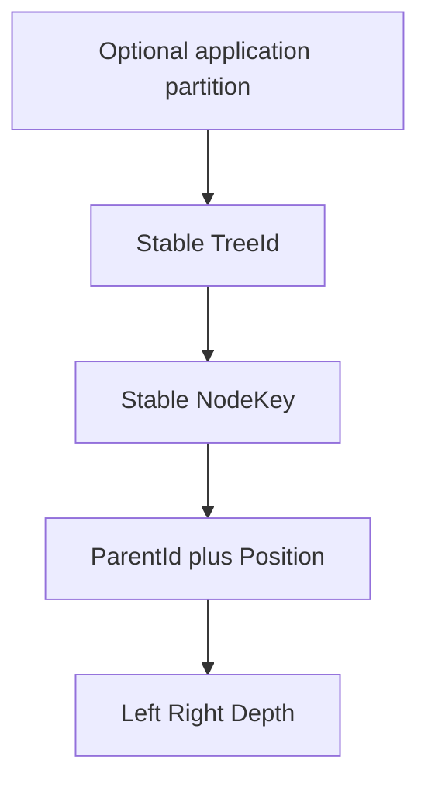

Without Scope, TreeId alone identifies a tree. With Scope, `(Scope, TreeId)` is
the complete identity. Every tree has exactly one root and its own local bounds
from `1` through `2 * nodeCount`; unrelated trees may therefore carry identical
bounds safely.

Parent and Position are the repairable adjacency source. Left, Right, and Depth
are the materialized nested-set read model. A cross-tree move changes TreeId on
the complete subtree in the same transaction. A cross-Scope move is rejected.

A scoped parent relationship uses a `(Scope, NodeKey)` principal key. If it
is missing, finalization adds it as an alternate key. With inheritance, that
key is declared on EF's root entity metadata while the concrete hierarchy
remains the self-FK's principal entity type. The existing primary key and
restrictive parent deletion are preserved; root metadata ownership does not
merge concrete TPC stores or their collations.

## Physical identity comparisons

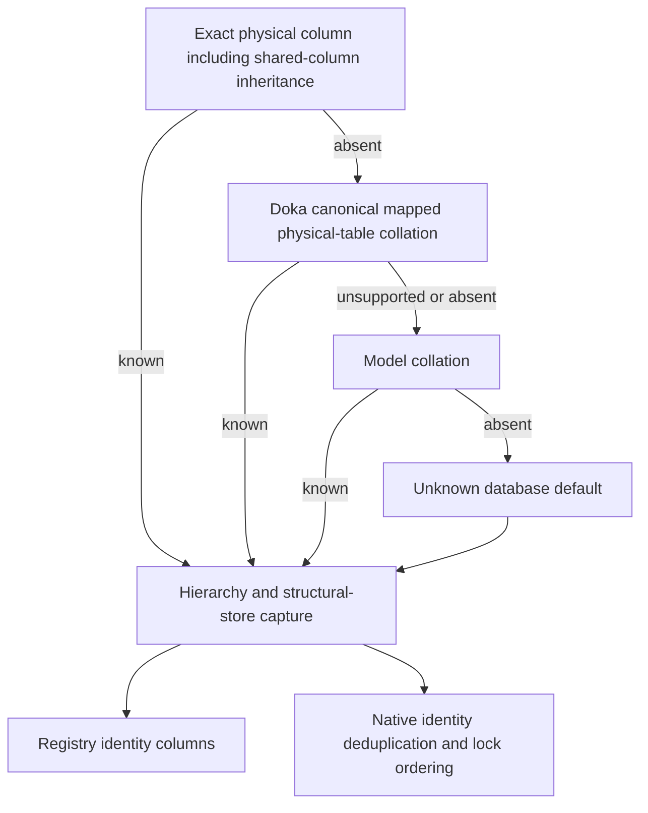

Collation resolution follows the actual structural store, including physical
column overrides and shared-column inheritance. Canonical table metadata is
consumed only through explicit provider capability wiring. Doka's supported
physical-table collation takes precedence over the model default; private
provider migration annotations are not copied. Only absent applicable
metadata leaves the database default unknown. With the current conventions,
runtime reads the captured owner facets without schema queries or
per-operation metadata scans.

Applicable owners include explicit split fragments and retain the original
mapped type while TPT visits ancestor tables; TPH and TPC stop at their own
mappings. A leaf's canonical table declaration can therefore apply to its
ancestor structural store through Doka's original-owner metadata. Resolving
only the CLR entity's current table would confuse structural and payload
stores.

When multiple applicable owners declare different table default values for the
same physical identity column, NestedSet rejects that ambiguous configuration.
Doka itself selects the first annotated mapped owner. This narrower library
validation keeps identity independent of visitation order; an explicit column
collation overrides the table declarations before ambiguity is checked. TPT,
TPC, table splitting, and entity splitting remain supported mapping shapes.

An inherited property can be shared by two concrete TPC tables with different
collations. Capturing one value on that property would conflate their physical
identities, so capture belongs to each hierarchy owner and its resolved store.
Registry columns and native identity rowsets use the same effective facets.
Concrete TPH and TPT bindings normalize to their configured ancestor owner for
query, mutation, and coordinated-save comparisons. Managed save factories are
cached by that exact owner, and their generic entity type is the owner's CLR
type. Changes to sibling derived types share one lock and ordering plan;
tracked descendants remain eligible for structural refresh. Owner resolution
is cached with the model rather than scanning the inheritance chain for every
changed node. This does not merge named shared mappings or independent
concrete TPC hierarchies that merely share an inherited property object.
Captured string facets serialize on the hierarchy owner, including an empty
string for a genuinely unknown default. A missing owner facet requires model
regeneration and cannot silently mean the same thing as that empty capture.
Case-distinct binary Scopes can therefore share one TreeId without a registry
silently merging their identities through another default collation.

The tracked-membership guard also preserves the separate MySQL equality-folding
boundary described in [D-012](decisions/D-012-typed-tree-runtime.md). Its internal
typed candidate Scope marker translates to the column-native STRCMP comparison
on MySQL/MariaDB string provider representations; the indexed request equality
and key transport remain unchanged. This protects known collations and
genuinely unknown database defaults without guessing or discovering a server
collation. PAD SPACE aliases remain aliases, while NO PAD identities retain
their distinct trailing spaces.

## Query engine

Principal-key collation depends on the effective provider representation,
including value conversion, rather than only the CLR key type. Parent joins
apply generic `EF.Functions.Collate<TProperty>` to the model-typed dependent
operand. EF translates that marker after applying the property mapping;
the indexed principal column keeps its own comparison semantics. Native
non-string keys do not gain a collation expression.

Public hierarchy queries are deferred, no-tracking `IQueryable<TEntity>`
expressions rooted in the application's entity set. `TreeContaining(nodeKey)`,
`SubtreeOf(nodeKey)`, `AncestorsOf(nodeKey)`, and the other anchor queries use a
database join against the visible anchor; callers do not load the anchor first.
Tree identity and boundary predicates expose the configured indexes to the
database planner. Direct parent and child queries join mapped ParentId and
NodeKey using the principal key's database comparison. These query shapes use
relational joins rather than requiring SQLite to support `APPLY`.

Result queries retain global query filters. Internal structural reads ignore
those filters so a hidden node cannot produce incomplete interval arithmetic,
then reapply the mandatory Scope and TreeId predicates owned by the library.
Preorder is the persisted Left order. Additional application predicates remain
composable before materialization.

The [generic composition contract](query-composition.md) adds range-pair
projections and existential row filters to the same query engine:

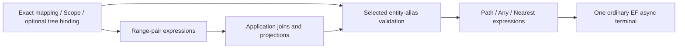

Projection substitution compares ParameterExpression identities and reduces
anonymous or simple member-initializer members. It never compiles application
predicates or invokes entity getters. Selected endpoints retain their exact
mapped owner; unrelated fact roots remain legal payload. Direct foreign
providers and LINQ-to-Objects sources are rejected before enumeration; nested
foreign contexts remain subject to EF's pre-command translation guard.

Endpoint analysis has three separate responsibilities:

- Mapping resolution requires a real entity alias of the exact configured
  mapping, including named mappings; an object with matching key values is
  not an endpoint.
- Source stability decides whether that resolution may be reused within the
  current operation. Mutable expression metadata must be inspected again.
- Visibility proof decides whether an additional membership check is
  redundant. A stable `IgnoreQueryFilters` expression still fails this proof;
  stability cannot authorize access to an otherwise hidden endpoint.

The last two checks deliberately remain separate contracts. Shared primitive
metadata checks may reduce duplication, but must not turn a stable source into
a visibility guarantee or narrow supported entity-alias shapes.

Source classification inspects children before reading a parent's derived
expression type. Ordinary framework constructor and index expressions can
forward that read to virtual constructor/property metadata; constant types can
likewise carry application-owned `Type` wrappers. Both the query-operator
pre-pass and fact-source inspection require actual runtime-owned metadata and
types before type/assignability checks. Opaque metadata and dynamic expressions
retain conservative strategy selection without getter execution or dynamic
reduction. Ordinary runtime metadata retains its existing classification.
The observation starts after the caller finishes building the expression:
public expression factories can legitimately validate metadata during setup.

Path checks join visible direct parents and children using the shared mapped
Parent primitive, retain complete Scope/Tree identity, and require consecutive
mapped depths. Their visible allowed-edge count must equal endpoint distance.
Any remains a visible existence query. Nearest first selects one scalar NodeKey
by descending mapped depth, exposes that key for the owner lookup, and gates
the complete-path count after the selected owner's predicate. These choices
were driven by actual provider plans, not an assumption that SQL evaluates
AND predicates in source order.

The expression helper caches closed public EF.Property MethodInfo metadata
through weak Type keys. This removes repeated overload discovery during query
construction without retaining contexts, entities, values, or result sets.
Queryable expressions and captured application values remain owned by the
individual deferred query. See [D-018](decisions/D-018-generic-hierarchy-query-composition.md)
for alternatives and re-evaluation triggers.

Scope and TreeId bindings accumulate typed comparisons in one library-owned AND
predicate over the original visible root. Rebinding retains every earlier
comparison and its private identity snapshot; a contradictory binding yields
no rows. Only library-owned comparisons participate. Caller predicates remain
separate, deferred expression occurrences, and global filters retain their
ordinary EF behavior. This reduces actual repeated method visits without
rewriting consumer expressions or weakening endpoint provenance.

### Optional ancestor index and statement-local source binding

Strict ancestors also have a source-bounded ordinary-model route in
[independent ancestor pairs](../src/Doka.EntityFrameworkCore.NestedSet/Features/Queries/NestedSetQuery.AncestorPairs.cs).
With verified public source-binding and ordered-join capabilities and an eligible
independent selection, it completes only NodeKey, TreeId, Left, Right, and optional Scope. A fact-bearing
selection retains its own structural `DISTINCT` boundary before completion;
plain scalar selections do not add that boundary. Neither operation deduplicates
consumer occurrences or fact payload.

The completed source supplies per-Scope/tree envelopes. Nonleaf owner
coordinates come from the unbound mapped root with global/model filters intact;
source-derived native point comparisons supply library Scope/Tree restrictions
so the existing Right index can range-check each envelope. Necessary envelope
limits are followed by all four original interval comparisons. When the existing
public engine API positively identifies MySQL, a nested binding then completes
only matched source/owner key pairs, with no `DISTINCT` over their occurrences.
Its recursive completion fence separates repeated direction changes from one
merged payload-hydration/EXISTS optimizer search. MariaDB and unknown engine
identification keep the outer source binding without the inner matched-key
completion. Source hydration stays ordinary on both routes; one verified
directed edge constrains final mapped-owner hydration. Exact final mapped
containment and visibility checks remain. Completion is once for each binding,
not once globally across distinct composition operations.

No generated nonleaf property, new index, migration, or public API is required
for this strict route. Missing either provider capability or a hierarchy-correlated
selection keeps the established independent-coordinate path. MySQL's intermediate
matched-pair relation may reduce downstream predicate pushdown; fewer optimizer
edges do not guarantee cheaper reads or allocations. Applying that additional
boundary to MariaDB exhausted the recorded branched-chain sample container, so
it is not shared across engines. The existing public engine API suffices for
this distinction. The optional generated-index
and inclusive readers below retain their separate eligibility.

The indexed path shares immutable source/candidate coordinate selectors through
a weak cache keyed by the exact finalized `IEntityType`. Constant configured
property names preserve EF translation and converters without retaining a model,
context, request or query root. Eligible Left/Right roles use exact mapped CLR
property or field expressions through the existing metadata-aware access helper;
the member must resolve to that same finalized property and cannot be an indexer.
Shadow, complex and otherwise ineligible storage retains EF property markers.
Object-valued identity roles and the generated Boolean retain their translation
markers. No mapped CLR getter runs during construction. Different models and
named mappings remain independent. This template reuse does not reuse visibility proofs or finished
queries. Upward projection substitutes the caller's original parameters once;
one-, two- and three-argument expression visitors avoid temporary argument arrays
while retaining the general path's exact simultaneous substitution semantics.

Catalog evidence uses exact identity and ordinal tuple sets. Aggregate state
stores selected scalar sums by representable cell offsets and foreign identities for
duplicate detection; larger selections build identity lookup maps lazily. It
does not reserve the complete Cartesian grid before reading. Duplicate rejection
still precedes final checked sizing, and the sample result remains one
ordered cell array with missing values distinct from measured zero. DTO histories
are not retained, but EF still creates projections and the evidence, sums and
final output consume population-dependent memory. See the
isolated EF and read qualification (planned documentation: `qualification/query-performance.md#ef-ownership-experiment`)
for the current measurement boundary.

Early declaration does not repair the published Doka 10.5.0 string-budgeting
defect. When Scope, TreeId, and NodeKey all have implicit `utf8mb4` lengths,
Doka assigns 255 characters to each and promotes those inferred lengths to
explicit metadata. The new index then needs 3,077 bytes against the tested
3,072-byte InnoDB key limit and fails with native error 1071 on both engines.
The provider cannot rebudget the later index despite its correct finalizer
ordering. Explicit application-domain lengths are qualified separately; the
library neither silently truncates identities nor imposes arbitrary lengths.

The corrected private provider used for that qualification solved complete implicit index budgets and
compatible principal/dependent groups before publishing facets. The actual
NestedSet consumer passes its [separate native acceptance](qualification/query-composition.md#optional-ancestor-access)
with Id, Scope, TreeId and ParentId all at length 254. This remains provider
metadata work; NestedSet's identity validator is unchanged. That historical
qualification predates the provider-package dependency boundary in D-020.
The MySql adapter now declares published Doka 10.6.2 as its minimum native
dependency and qualification input, independently of those frozen local results.

The MySql adapter binds Doka's published public source-binding, ordered-join,
and engine APIs directly. Its declared native dependency is Doka
`[10.6.2,10.7.0)`; it does not discover optional declarations by names or share
an assembly/signature/delegate lookup registry with the common kernel. The
selected adapter and configured native provider must have matching exact
runtime identities. Source and ordered-join method identities used for query
provenance come from typed public methods. Query state, contexts, and request
values are not cached in those identities.

With the explicit model option, eligible strict ancestor queries bind their
completed selected source within one SQL statement. Inclusive queries also use
the adapter's required ordered-join API. Both require the independent-owner
policy and an eligible selection. Other adapters retain their corresponding
portable read strategies, including the informational schema-only ancestor
index diagnosis. The
[canonical selection rules](configuration.md#current-query-capabilities)
distinguish independently inspected fact roots from hierarchy-bearing or opaque
sources.

#### EF-normalized captured sources

[Deferred query dispatch](../src/Doka.EntityFrameworkCore.NestedSet/Features/Queries/NestedSetDeferredQuery.cs)
recognizes exactly five private operations:
[strict/inclusive ancestors](../src/Doka.EntityFrameworkCore.NestedSet/Features/Queries/NestedSetDeferredQuery.Ancestors.cs)
and [Path/Any/Nearest filters](../src/Doka.EntityFrameworkCore.NestedSet/Features/Queries/NestedSetDeferredQuery.Filters.cs).
Markers carry existing query syntax, exact mapping identity and tree-bound
mode. Construction reads no captured query, application field or getter.
Source-sensitive ancestor normalization applies to every options-registered
provider; choosing the optimized index reader still separately requires the
opt-in schema, Doka and the verified public capabilities.

A downstream filter defers only if its source already contains an exact owned
marker. Existing source/scope/null/endpoint guards run before marker creation.
At expansion the same normalized path, existence or nearest core performs its
normal proof, including candidate-before-value rejection and no farther
fallback. Unmarked filters keep their ordinary construction path. No second
semantic implementation or application query provider is introduced.

The [stateless injected interceptor](../src/Doka.EntityFrameworkCore.NestedSet/Features/Queries/NestedSetQueryExpressionInterceptor.cs)
expands only those exact definitions after EF's ordinary parameter/capture
processing and before relational translation when compilation is needed.
EF owns capture values and the compiled-query cache. A later terminal sees a
rebound source under EF's normal processing; the interceptor does not replace
cache keys or replay application getters on cache hits.

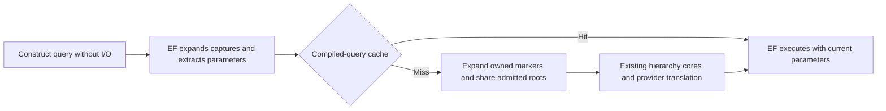

Expansion validates exact mapping against the compiling context and inspects
actual normalized fact roots/filters before selecting the indexed or existing
strategy. Scalar query parameters remain leaves; a query-valued parameter
cannot prove independence. Nested operations expand with the same
compilation-local visitor. Weak typed expansion delegates retain no context,
model, application capture or completed query.

[Normalized owned-root sharing](../src/Doka.EntityFrameworkCore.NestedSet/Features/Queries/NestedSetNormalizedQueryRoots.cs)
canonicalizes only the marker's visible and unbound roots within one compilation.
EF can detach and rebuild equivalent root occurrences during extraction;
restoring their reference sharing lets the existing endpoint proof recognize
the same binding. Admission first checks the entire restricted grammar: exact
EF metadata, scalar parameter identities and approved literal kinds remain
part of equality. Custom values/arrays, reducible or application-owned syntax
are not admitted to comparison. The comparer therefore cannot invoke an
application equality/hash implementation, getter or reduction callback.
No consumer source tree or global query cache is created by this mechanism.

[Late closure normalization](../src/Doka.EntityFrameworkCore.NestedSet/Features/Queries/NestedSetNormalizedQueryClosure.cs)
folds only this library's compiler-generated fields introduced after EF's
extraction boundary. Exact EF-owned query objects can supply their expression;
application properties, fields and custom query objects are not evaluated.
This prevents newly composed library closures from retaining a live context in
the translated graph without stealing EF's application-evaluation responsibility.

The interceptor exists only with options registration. Model-only contexts
retain the previous expression strategy and emit no deferred marker. An absent
index option or capability cannot be enabled by normalization. Some cold proof
construction moves from the public builder to compilation; whole-reader cold
and warm measurements must qualify its cost separately from builder allocation.

[Shared syntax admission](../src/Doka.EntityFrameworkCore.NestedSet/Features/Queries/NestedSetQuerySyntax.cs)
owns runtime/EF node and reflection-metadata checks. Query-bearing syntax,
independent fact roots, memoization stability and exact endpoint
mapping/visibility remain distinct proofs. Admitting one root does not grant
another endpoint its provenance or permit mutable-source memoization.
The measured SQL strategy families retain their separate qualification.

An independently inspected query-bearing fact selection first keeps its narrow
structural source in a separate query block with `DISTINCT`, before the public
completed-source binding. The projected coordinates contain the authoritative
root's complete unique NodeKey, TreeId, and optional Scope identity, so this
boundary preserves its selected rows. It contains no consumer occurrences or
fact payload; later fact joins and their bags are unchanged. Plain scalar selections do not add
this boundary. The boundary reuses the eligibility result without another
predicate inspection; query-bearing eligibility still uses its initial
query-operator check followed by independent fact-source inspection.

The boundary prevents the observed MariaDB merge of fact `EXISTS` into the
recursive anchor, which otherwise repeated fact checks across the source-node
population. It constrains that merge without a SQL hint or another provider
API. Derived-table merge eligibility is not a universal cost guarantee: native
qualification still checks exact fact selections and both engines' actual
plans, work, and allocations. Hierarchy-bearing and opaque pivots keep their
existing strategy.

Source envelopes group by physical
Scope when configured and TreeId,
retaining maximum Left, minimum Right, and a nonempty-group marker. Candidate
owners start at the original unbound mapped root with all application/global
filters intact. Source-derived identity points supply the library's Scope/Tree
restriction without copying its constant prefixes to that candidate root.
Private translated closed-point ranges preserve native mapped types,
converters, and collations while exposing source-dependent range work to
MariaDB. They add neither a public knob nor an index hint.

Strict candidate owners retain their own physical Key, optional Scope,
TreeId, Left, and Right through DISTINCT. All four original strict comparisons
then reject source/candidate nonmatches while both remain narrow coordinate
rows. Only surviving matches project keys for the existing mapped identity
joins; the final actual aliases still enforce all four original comparisons.
Keeping only keys before this filter can turn the necessary source envelope
into millions of rejected mapped-owner lookups. The inclusive
strategy captures the generated flag in the completed selected source, in
addition to Key, optional Scope, TreeId, Left, and Right. Each source enters
nonleaf mode; only false-flag positive-width sources enter leaf mode. A
thousand-node selected chain with one leaf therefore has 1,001 source modes,
rather than two modes for every selected node.

Each candidate arm projects its own physical Key, optional Scope, TreeId,
Left, and Right and applies DISTINCT before mode/mask projection. Both arms
therefore retain aligned native identifiers for EF collection shaping, without
merging equal-bound nodes with different keys. Their union is completed by one
additional dependent source binding; no actual entity or collection payload
crosses that boundary. Equality mode/mask columns precede range coordinates
in the structural projection so MySQL can retain its automatic composite key.

The bounded source-mode and candidate-owner unions use one public
`StraightJoin` call to place source modes before the completed narrow candidate
relation. The key retains mode, complete partition identity and exact leaf or
masked nonleaf coordinates. All four original comparisons reject nonmatches
while they are still narrow structural rows.

After ordinary source-entity hydration, a second call to the same API places
the candidate-bearing selected relation before final mapped-owner hydration.
The original source/candidate edge alone does not constrain that later owner
alias: an optimizer can still drive payload owners before candidate matching
and repeat a large prefix without changing the final result bag. The second
edge constrains that exact owner boundary. Source hydration stays an ordinary
join so the optimizer can reuse selected sources rather than forcing a lookup
for every expanded pair. Other consumer and payload-source joins also stay
ordinary. This is two invocations of the existing single-edge API, without a
pair spool, new provider capability, option or relaxed work allowance.

Each endpoint rejoins its own complete mapped identity, and final aliases
retain all four comparisons and application filters. Neither union fences final
pair output or deduplicates consumer bags. No SELECT-wide option or SQL-text
rewriting is used. The directed edges alone do not prove bounded native work;
exact bags, completed plans and unchanged work budgets require separate runs.
Those aliases retain the existing database query-consistency boundary; the
strategy does not introduce a stronger snapshot or read-uncommitted contract.
The endpoint validator resolves the verified source binder's lexical parameter
back to the exact original root. It separately recognizes only the exact
verified public ordered-join method and retains each input's own mapping and
visibility; the join is not treated as another source binder. It
must not grant visibility to arbitrary methods, filter-stripped aliases,
foreign contexts, or another named mapping.

Neither directed join guarantees result ordering, a stronger snapshot,
materialization or speed. Other joins remain subject to engine rules rather than a complete
fixed order; MySQL semijoin eligibility can change as an engine consequence.
The generated schema and optional API availability remain separate contracts,
as recorded in [D-019](decisions/D-019-optional-ancestor-index-and-source-binding.md).

Endpoint resolution retains one exact lexical scope per binding call and
parent environment within the operation. Stable endpoint results use member
paths relative to the current lambda parameter plus incoming visibility, so
equivalent selectors share work while alternating members and mappings remain
distinct. Captured query objects with mutable expression metadata are not
eligible for that memo, including runtime queries carried in object-typed
fields. Opaque query properties and static fields cannot supply endpoint
provenance or bound-source visibility through casts, type-as conversions or
AsQueryable. The guard does not execute application property getters to obtain
that proof. Statically known query inputs and ordinary object payloads retain
their respective supported visibility and stable-source reuse.
Recreating a scope on each branch expanded a compact
source DAG into exponentially repeated guard work; the operation-local map
removes that expansion without introducing a cross-query visibility cache.

```mermaid
flowchart LR
    Model["Explicit model option"] --> Flag["Generated flag and additive index"]
    Capability["Exact public Doka source binding"] --> Select["Completed selected source"]
    Flag --> Gate["Eligible ancestor query"]
    Select --> Gate
    Gate --> Coordinates["Narrow coordinates and envelope"]
    Coordinates --> Direction{"Strict or inclusive?"}
    Direction -->|Strict| Strict["Own physical coordinates DISTINCT"]
    Direction -->|Inclusive| Ordered{"Exact public StraightJoin?"}
    Ordered -->|Available| Lanes["Source modes before completed candidates"]
    Ordered -->|Missing| Legacy["Existing inclusive strategy"]
    Strict --> StrictBounds["All four strict structural comparisons"]
    StrictBounds --> Keys["Matching keys only"]
    Keys --> Owners["Actual mapped owners"]
    Lanes --> SourceHydration["Ordinary mapped-source hydration"]
    SourceHydration --> OwnerHydration["Selected candidates before mapped owner"]
    OwnerHydration --> Owners
    Owners --> Exact["Exact Scope / TreeId / four bounds"]
    Exact --> Composition["Path / Any / Nearest / direction changes"]
    Legacy --> Composition
    Composition --> Execute["Ordinary EF async terminal"]
```

Hierarchy-bearing and opaque query predicates retain the established strategy
rather than forcing an eager boundary onto correlated mixed-direction pivots.
Explicit fact roots can complete independently only after the selection guard
checks their actual model and inherited/named filters, retaining fallback for
all EF navigation or skip-navigation expansion. A navigation target can hide
another filtered hierarchy dependency. Captured query getters are not evaluated
to establish that proof.
The index remains
available as schema metadata on all supported providers; the Doka source-sharing
strategy is a separate provider capability. Only eligible Doka ancestor
selections use the new strategy. PostgreSQL, SQLite, SQL Server, and Doka without
the required capabilities retain the existing overflow-safe nonleaf read path, including when the index
is configured. Neither schema availability nor source binding establishes an optimizer
complexity guarantee. See [D-019](decisions/D-019-optional-ancestor-index-and-source-binding.md)
and the [final local qualification](qualification/query-composition.md#optional-ancestor-access)
for the storage/write trade-off and re-evaluation criteria.

Ordinary EF schema creation and upgrades remain independent of migration
adapters. Historical published SafeMigrations 10.5.0 server adapters reject the scaffolded
raw computed expression; SQLite has a separately reproduced fresh-table
catalog/postcondition mismatch, while its populated ADD path succeeds.
Index-only replay/drift checks on ordinary EF-created schema do not imply
automatic generated-schema support. The exact
[adapter boundary](migrations.md#optional-safemigrations-generated-column-contracts)
is documented separately from the query-provider integration. The current
SafeMigrations contract covers canonical generated expressions and safe-owned
SQLite facets; its tests independently require full migrations, physical schema,
data/history preservation and guard-level replay. Existing schema drift and
invalid coordinate rows must still be rejected. The fresh 2026-10-25 local
public-graph run passed 11,726 cases with zero failures and 2,072 native SQL
Server ARM exclusions; [the provider record](qualification/provider-migrations.md#published-runtime-qualification-2026-10-25)
retains the nine-project scope. Dated private results keep their isolated graph
and are not transferred to new binaries.

## Mutation and lock protocol

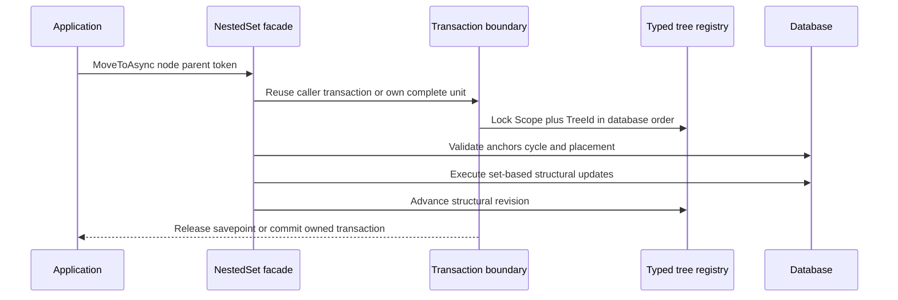

Each hierarchy owns an internal registry whose Scope and TreeId columns copy
the source store types, converters, facets, and collations. The database sorts
complete identities before multi-tree acquisition. Writers of one tree
serialize; writers of independent server trees do not pass through a global
library lock. SQLite preserves the same contract through its database writer
semantics.

An existing application transaction remains caller-owned and uses a savepoint.
Without one, the library owns the complete transaction. A retrying execution
strategy may retry only the complete application unit. Cleanup uses
`CancellationToken.None` after forward progress fails so an already canceled
token cannot skip rollback.

Single-node inserts, moves, and deletes use set-based range updates. The client
does not materialize every shifted node. The package rejects affected tracked
hierarchy entities before an explicit set-based mutation so the change tracker
cannot retain stale structure.

The executor receives explicit requests for new or existing registry
identities; it never discovers scope-wide trees as a fallback. Consistent
validation and rebuild planning have a separate read-lock path. That path
locks the exact inspected tree while preserving pending tracked changes and
performs no EF save or structural write. Coordinated parent changes execute
under their already acquired locks rather than creating another executor for
each node.
Tracked refresh captures are constructed directly with the known identity
types after native membership resolution, with every required field populated.

## Ordering and coordinated saves

Configured sibling order is stored in model metadata and translated with the
provider's store comparison. NodeKey is the final deterministic tie breaker.
Insert, move, rebuild, and automatic reorder therefore use the same database
semantics for direction, null order, conversion, and collation.

The SaveChanges guard rejects uncoordinated Parent, TreeId, Scope, or ordering
changes before payload SQL. Explicit mutations reject changes already recorded
as pending before the first identity lookup. After an awaited scalar lookup,
execution checks the tracker again before locks or writes because a command
interceptor can change it during that await. When automatic detection is
enabled, this check also discovers ordinary CLR edits not recorded earlier.
The affected-tree check reuses that detected state without a third detection
pass.

`NestedSetDbContext` or
`SaveNestedSetChangesAsync(...)` composes the application's existing save rule
with one coordinated transaction: capture changes, lock affected source and
target trees, save payload once, apply planned structural changes, refresh
tracked structure and store-generated tokens, then accept changes.

## Bulk import, validation, and rebuild

Bulk import validates detached input and topology before its first write. It
uses iterative traversal, compact planning buffers, deterministic multi-tree
lock order, and bounded 64-entity EF insertion batches. Each forest root has an
explicit TreeId. Write batches span independent trees, so 131 one-node trees
use three payload saves while still locking every identity before payload SQL.
A failed write restores captured CLR structural values where
the outcome is definite.

Single and bulk insertion share a bounded native identity lifecycle helper.
It owns exact introduced entries before their initial tracking transition,
captures installed key representations, and captures generated identities at
the existing relational persistence boundary before acceptance. Mutable key
representations are isolated through the configured comparer snapshots so
application callbacks cannot corrupt cleanup's hash lookup. Foreign-key
dependent buckets retain only the exact introduced dependent handles.

Ordinary detachment remains the normal lifecycle. A rejected initial
transition additionally removes its exact surviving reference or partial key
registration; a callback-mutated identity additionally releases its captured
map membership. No caller-wide clear, retracking cycle, artificial state
transition, or scan over all identity maps is used. Cached delegates retain
framework contracts, not context instances. The internal EF seam is explicitly
version-qualified. A separate model-free binding owner validates its required
member signatures once at `UseNestedSets` registration; incompatibility names the loaded
version and member before hierarchy writes. This structural check is not a
public EF compatibility guarantee or behavioral qualification of a future
patch. Registration checks scalar and nullable maps plus EF's actual
`IReadOnlyList<object?>` composite shape without compiling unused operations.
Closed map operations compile lazily when a model needs them. Unchanged scalar
refresh, identity matching, and detach preparation compare typed current, CLR,
and installed relationship values before allocating snapshots. There is no
public typed relationship-snapshot getter; the native generic reader compiles
once per property reader. Exceptional differing member/model types retain the
public object getters for EF's sentinel conversion semantics. Typed comparer
bodies retain both operand null guards. Dependent-bucket lists are allocated
only when an entry actually has a native bucket membership. Mutable reference
keys retain protective snapshots at every boundary. Failure recovery
audits the distinct touched maps once for exact residual introduced entries.
This read-only audit runs only after failure, requires bounded batch memory,
and can take linear time in caller entries in those maps. An irrecoverable
callback-corrupted hash slot requires context disposal instead of silent reuse.

Quick validation uses indexed aggregate and local invariant queries. Full
validation loads compact structural projections and traverses iteratively.
`PlanRebuildAsync` is write-free. `RebuildAsync` locks exactly one tree, rejects
invalid adjacency before its first update, and writes only changed structural
rows in bounded batches.

## Registry lifecycle and administrative purge

Deleting the complete root or calling `DeleteTreeAsync` changes the registry
identity from active to tombstoned in the same transaction. The tombstone
prevents accidental reuse after a delete, delayed message, or retry.

`PurgeTreeIdAsync` is a separate administrative operation. It locks the exact
tombstone, verifies through an unfiltered Scope-and-TreeId query that no nodes
remain, and deletes exactly that registry row. It rejects missing identities,
active trees, unsupported lifecycle values, and tombstones that still own
nodes. After commit, deliberate reuse is possible. The application owns
authorization, audit retention, and the decision that no external reference
still depends on the retired generation.

## Provider boundary

The selected provider service delegates native lock SQL, registry rowset
encoding, session prerequisites, supported isolation/snapshot policies,
set-update details, generated-column expressions, collation handling, physical
query strategies, and SQL translations to the corresponding adapter. The common
engine retains lifecycle validation, deterministic lock acquisition, mapped
parameter execution, transaction ownership, and shared structural algorithms.
It does not dispatch through concrete provider-name strings or a provider enum.

MySql binds the required public Doka APIs directly. Exact source/ordered-join
method identities still belong to query-provenance validation; they are captured
from typed public methods rather than optional string/signature discovery.
Neutral structural query markers remain common and are translated by the
selected adapter only. No process-wide assembly discovery is introduced.

All value parameters come from finalized relational type mappings. Physical
identifiers come only from trusted model metadata and the selected provider's
SQL identifier helper. Each adapter has a direct dependency on its native EF
provider; the common kernel has none. Pomelo is outside the contract. Ordinary
EF migrations remain the required baseline; SafeMigrations is independently
optional. Package declarations and actual executed qualifications are separated
in [the support matrix](support-and-qualification.md).

## Diagnostics boundary

Explicit mutations, coordinated saves, validation, and rebuild execute inside
the package telemetry boundary. Activities and metrics expose bounded
operation, outcome, provider family, failure class, duration, lock wait, rows
affected, batch count, and rebuild node count.

NodeKey, Scope, TreeId, entity or table names, SQL, connection data, exception
messages, and payload are never emitted as library tags. When no listener is
enabled, the operation task passes through without an additional async state
machine. Deferred query execution remains visible through EF Core diagnostics.

## Source layout

| Area | Responsibility |
| --- | --- |
| `src/Doka.NestedSet` | EF-independent optional contracts and pure semantics |
| Package root | Public context, query, and mutation entry points |
| `Features/Insert`, `Features/Move`, and `Features/Delete` | Single-node and subtree mutations |
| `Features/BulkImport` | Bounded forest planning, insertion, and refresh |
| `Features/Queries` and `Features/Facade` | Composable tree queries and the mutation facade |
| `Features/Ordering` and `Features/ManagedSave` | Sibling order and coordinated SaveChanges |
| `Features/Maintenance` | Registry lifecycle, inspection, repair, and rebuild |
| `Configuration` and `Mapping` | Structural roles, conventions, and finalized immutable metadata |
| `Execution` and `Providers` in the common package | Shared transaction/tree-lifecycle coordination, retries, and the internal provider boundary |
| The four adapter projects | Native SQL/rowsets, physical model conventions, query primitives/translators, and native callback registration |
| `Storage` and `Shared/Structural` | Typed relational access and structural primitives shared by features |
| `Diagnostics` and `Errors` | Bounded telemetry and stable failure codes |

The public namespace stays `Doka.EntityFrameworkCore.NestedSet` regardless of
the source folder. The internal feature namespaces reflect ownership; shared
storage, mapping, and transaction code remains outside the feature folders
because multiple operations consume it. Feature folders retain the common
algorithm owners; the provider boundary is a real project/dependency boundary.
Selecting an adapter does not create a per-node handler or duplicate a feature
algorithm.

[D-011](decisions/D-011-feature-oriented-source-layout.md) records the runtime
source layout.

## Test project ownership

All test projects sit directly under the solution's `tests` folder. The
`Doka.EntityFrameworkCore.NestedSet.Specification.Tests` project compiles the
common integration assertions, models, and reusable infrastructure once. It is
a non-runnable, non-packable library. Its common test suites are public abstract
classes, including nested suites; they are not independently discovered tests.

The four provider projects reference that library and own thin concrete
subclasses for every common suite with an applicable declaration on that engine.
xUnit discovers inherited methods
on those concrete classes. The MySql project contains separate same-named MySQL
and MariaDB suites; MariaDB wrappers live under its `MariaDb` folder and namespace.
PostgreSql, SqlServer, and Sqlite own their respective engines. A suite remains
structurally owned while at least one declared method applies. Wholly excluded
families have no wrapper, so raw IDE metadata cannot advertise their unsupported
methods. Partially excluded families retain their wrapper and specific exclusions.
A common method and every scenario variant must
span more than one executable provider project after combining method and row
exclusions. MySQL and MariaDB share one executable for this ownership rule.
Provider-exclusive test bodies and helpers live in that project. Models and
test-free support retain their common identity only where shared and local
consumers actually need it. Unit tests own their test bodies and reference the
specification library for shared infrastructure. No project compiles linked
copies of common sources. Ordinary migration and optional SafeMigrations
qualification remain separate.

`NativeGuardProbe`, `ScaleProbe`, and its shared `ScaleCommand` observation are
independent internal helper types. Their shared and provider-local consumers
reference them directly without nesting dependencies or global aliases.
Suite-private observers stay private. Moving a command probe does not change
its context correlation, subscriptions, disposal, or measurement boundaries;
existing context and entity CLR types retain their model and cache identities.
Provider-only files follow feature folders, including SQL Server tree-registry
tests under `Concurrency/TreeRegistry` and row-version tests under
`Ordering/Tracking/RowVersion`.

All providers keep wide registry-rowset tests in `Concurrency/TreeRegistry`.
SQL Server separates `WideRowsetLockTests` from `ScopeValidationTests`.
Its row-version suite, fixture, and context use the local names `RowVersionTests`,
`RowVersionFixture`, and `RowVersionContext`; the SQLite writer-timeout suite
uses `WriterTimeoutTests`. The row-version entity retains its
`SqlServerVersionNode` short name and explicit physical mapping. Provider-only
model and support files use their provider namespace. These namespace moves
intentionally change CLR and model-cache identity, while entity short names,
explicit physical tables, inheritance mappings, and existing measurement
warmups remain intact. Fresh builds and model tests qualify the changed identity.

`QueryPlanTestSupport` owns shared statistics refresh, native plan explanation,
and asynchronous evidence writing independently of any query-plan suite. Shared
and provider-local callers use it directly, preserving provider-specific SQL,
captured parameter bindings, command selection, output names, and cancellation.

Key comparison and hierarchy-plan cases are separately discovered scenario rows.
`KeyFilterComparisonFixture` owns one additional read-only comparison database
for its 1,024-row seed, independent of its resettable sibling-test database.
`ServerQueryPlanFixture` owns the immutable 4,000-node hierarchy-plan seed.
Both acquire resources lazily after the database-platform
hook and reuse the existing assembly-owned servers. Each scenario opens a fresh
context. Class-owned evidence is emitted once during asynchronous disposal in
the original deterministic scenario order; rows do not overwrite the legacy
`<Engine>-key-filter` or `<Engine>-hierarchy` aggregate.

Large metadata-guard and retention suites retain their owning test types while
separating annotation, ownership, discovery, probe, helper, and model source
files. This does not change test discovery, collection serialization, no-inline
GC frames, or reference lifetimes. Project-level partial-family metadata is an
IDE aid, not another compiled source owner; compiler inputs and actual discovery
remain separate verification boundaries.

Common suites are nongeneric and accept an `IProviderFixture<TResource>` view in
a protected constructor. Each concrete leaf exposes one public constructor with
the exact registered `ProviderFixture<TResource, TEngine>` specialization and
forwards it to the shared constructor. That fixture exposes immutable `Engine`
and `Value`, constructs the existing resource once, and forwards asynchronous
initialization and disposal at its registered lifetime. Shared methods obtain
`Engine` from this fixture instead of theory arguments or ambient assembly state.
Metadata-only suites use `ProviderResources`; discovery and structural audits
read the concrete fixture type without constructing database resources.

Ordinary `Fact`, `Theory`, `InlineData`, and `MemberData` are the common default:
every concrete engine runs the same engine-neutral scenario arguments.
`EngineFact` and `EngineTheory` express method exclusions with exact engine names
and a nonempty reason. `EngineInlineData`, `EngineMemberData`, and
`EngineTheoryDataRow` retain justified variant exclusions. Excluded methods are
omitted before fixture construction; excluded rows are filtered when xUnit
enumerates their source. Unexpected empty data is a visible failure, not a skip.
Discovery does not pre-read member factories to decide eligibility and then
enumerate them again. Existing scenarios remain preserved while common cases
previously limited by arbitrary engine sampling run on all concrete engines.

Fixture-owned provider-local suites use ordinary fact and theory annotations
with engine-neutral scenario data. The actual leaf's exact closed fixture
supplies engine ownership. MySQL-family bodies and exclusive helpers compile
once in local abstract feature suites; separate MySQL and MariaDB leaves supply
their exact fixtures. Each of the seven local families has one `*TestBase.cs`
file and one type per concrete leaf file. Existing named collection declarations
sit explicitly on the leaves. The `ScopeAliasRowset` family retains class-owned
fixtures and has no named collection; consistent source layout does not alter
its resource lifetime. A MySQL-only NO PAD test is declared only on the MySQL
leaf. Local suites do not inherit common test-bearing suites and therefore do
not execute retained common cases a second time.

The local guard audits effective inherited methods whose declaration belongs
to the executing provider assembly, including abstract family declarations.
It keeps common-library declarations under the separate shared-contract guard.
Scenario strings, even engine-looking strings, are payload rather than engine
selectors. An ordinary local `MemberData` source retains its explicit
`MemberType`; an unset value resolves through the concrete leaf and its base
types, matching xUnit's public metadata initialization.

All local suites follow this fixture-owned contract. The former `Provider*`
attributes, their discoverers, and legacy row-selection guard branches are
removed. `ProviderEngineOwnership` retains one known-engine and executable
catalog containing each engine's exact name, marker type, and executable.
Known-engine checks, executable membership, owned-engine enumeration, expected
closed model-collection fixture types, and the common-coverage executable count
derive from this immutable catalog. Its explicit assembly lookup serves
discovery and metadata guards;
its ambient lookup serves current-assembly server and metadata checks. Neither
supplies the engine of a fixture-owned test. Missing or foreign fixtures,
engine-selector arguments on neutral cases, invalid inherited annotations,
empty sources, and exclusions that collapse a common variant to one executable
owner fail visibly.

Resolving an engine against the actual suite assembly does not validate a
separate assembly supplied by an audit caller. The local guard therefore checks
that the audit owner also owns the resolved engine. The redundant unknown-engine
branch is removed after engine resolution, while the foreign-audit-owner
regression retains this independent boundary. Custom fixture marker types still
resolve through their static engine name; the built-in marker catalog defines
expected registrations without imposing another marker-type restriction.

The five `ProviderAnnotationTests` methods inspect metadata once per executable.
Their explicit MariaDB exclusions explain that MySql audits the same assembly
inventory. Both sealed engine wrappers and the full MySQL/MariaDB owned-engine
set remain in that audit. Exactly five duplicate metadata cases disappear;
no database behavior scenario is omitted.

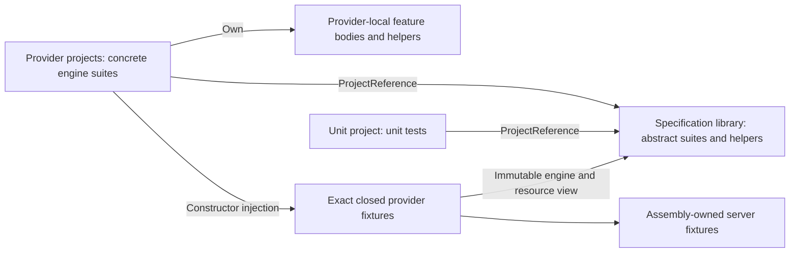

Each provider assembly registers its own `TestDatabaseServers` fixture and
public named collection definitions. The fixture starts containers lazily,
at most once per owned server engine, and disposes them after that assembly's
collections finish. A complete MySql run uses one MySQL and one MariaDB
container; PostgreSql and SqlServer each use one, and Sqlite uses none. Separate
assemblies do not share a static fixture singleton, even in one test process.
Database creation resolves the executing assembly's fixture asynchronously
from xUnit's current class or test context.

Server reuse and database reuse have different boundaries. The shared suites'
class or collection fixtures own their existing database resources. MySql's
`Model compatibility` collection registers both closed
`ProviderFixture<ModelCompatibilityDatabase, MySqlEngine>` and
`ProviderFixture<ModelCompatibilityDatabase, MariaDbEngine>` types. A common
model suite injects its exact collection fixture without a class registration
that would shadow it; the collection preserves its existing serialized reuse.
Provider-local model suites also inject their exact closed collection fixtures.
The unbound `ModelCompatibilityDatabase` collection registrations are removed
from MySql and SqlServer; each retained engine-bound fixture still creates and
owns its resource at the same collection lifetime. Individual tests may share
their fixture's database while isolating their data.
`ProviderCollectionFixtureContract` compares the complete set of
`ICollectionFixture<>` registrations with the catalog's exact expected set.
It rejects missing or foreign engine fixtures, wrong resources, restored bare
`ModelCompatibilityDatabase`, and unrelated registrations without constructing
resources. Filtering only recognized engine-bound fixtures would conceal extra
resources that xUnit initializes for a collection with an eligible case, even
when no test constructor requests them. Positive and negative metadata tests
protect this registration boundary separately from constructor injection.
The `Allocation measurements` collection retains disabled parallelization.
Its definition is local to every consuming executable assembly, including Unit;
a metadata guard rejects a missing or duplicated local named collection.
This preserves the current isolation and parallelism contract without claiming
one database per test.

The constructor guard uses public xUnit metadata for the actual concrete class
and its resolved collection and assembly. It models exact fixture lookup,
including supported generic registration normalization, along the class,
collection, and assembly parent chain. Test constructors may also receive the
exact `ITestOutputHelper` or `ITestContextAccessor` interfaces, or use xUnit's
default, optional, and parameter-array fallbacks. Nullable annotations or an
assignable registered type do not satisfy an unresolved required parameter.

Fixture constructors have a separate contract: they receive `IMessageSink`,
`ITestContextAccessor`, or a fixture from a parent scope. Same-level dependencies
and test-constructor fallbacks are not fixture-constructor support. The guard
checks these dependencies even for registered fixtures unused by the test
constructor. Positive and negative regressions cover inherited registrations,
named and type-based collections, nested-class boundaries, missing exact
registrations, and constructor shape without initializing resources. This
contract is scoped to the repository's ordinary reflection-based xUnit runner.

[D-013](decisions/D-013-provider-owned-integration-test-projects.md) records the
referenced specification strategy, the previous linked-source option, and its
discovery and fixture confirmation procedures.
