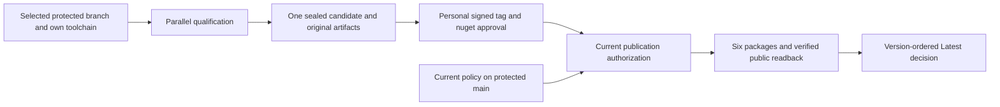

# Release lines

NestedSet uses one release contract for independently maintained framework
lines. [D-021](../decisions/D-021-release-lines-and-monotonic-publication.md)
records the decision. This capability keeps the actual source on .NET/EF Core
10 and package version `10.1.0`; it does not activate a branch or adopt .NET 11.

## Current configuration

The authority is [lines-policy.json](../../eng/release/lines-policy.json) on
protected `main`. Exact branch names, package majors, channels and upstream
stages are reviewed together:

| Exact branch | Role | Package major | Initial state |
| --- | --- | --- | --- |
| `main` | Main development | 10 | `active` |
| `maintenance/10.x` | Maintenance | 10 | `inactive` |
| `preview/11.x` | Optional platform preview | 11 | `inactive` |

The `x` is literal, not a wildcard. At most one active publication line owns a
package major. The optional preview entry grants no publication or scheduled
work while inactive. Ordinary feature branches remain ordinary nonpublishing
development branches.

| State | Allowed behavior |
| --- | --- |
| `inactive` | Preparation PR checks; no release qualification, scheduled maintenance or publication |
| `prepared` | Complete own-line qualification with `qualification-only`; no publisher environment or credentials |
| `active` | Own-line qualification, scheduled maintenance and authorized publication |

Every admitted source uses its own workflow, `global.json`, target framework,
EF/provider dependencies and test runner. The current `main` toolchain never
wraps another branch's source. Package inspection, isolated consumers and SBOM
checks use the selected line's framework contract too.

## Normal release

Use the existing [publication procedure](release-publication.md):

1. Merge reviewed release preparation into the protected authorized branch.
2. Update a clean checkout of that branch and run `./eng/pre-tag-check.sh`.
3. Select that branch in **Release candidate**, enter its unused canonical
   version and leave `qualification-only=false`.
4. Wait for the complete parallel qualification and attestations. Inspect the
   exact source SHA, version, candidate and original artifact identities.
5. Create and push the personally signed annotated tag on that SHA, then
   approve the same waiting `nuget` job.

The version suffix selects RC or stable; there is no second RC/stable flag.
The six existing packages share one version and one build/pack producer.
Original artifact IDs carry the unchanged candidate into publication. The
existing environment, reviewer arrangement, administrator bypass, signer
policy and Trusted Publishing identity remain unchanged.

For a prepared line, or a nonpublishing rehearsal of an active line, select
`qualification-only=true`. It completes the same applicable reversible
qualification and attestations but skips the entire environment-bearing
publisher job. Create no release tag and request no NuGet approval for that run.

## Frozen qualification and current permission

Qualification freezes the selected line alongside the existing source,
workflow, run/producer attempt, deadline and package evidence. It records the
observed policy identity. This adds no second candidate registry, per-lane
inventory, release database or separate publisher implementation.

After protected approval, publication independently reads current authority
from protected `main`, checks the selected protected source and rechecks its
active major/channel permission before public writes and credential use.
Candidate-local policy cannot authorize publication. Missing, inaccessible,
malformed or contradictory authority fails; a formerly active frozen line
cannot publish after its current grant is withdrawn or reassigned.



The common non-cancelling publication queue serializes all lines and versions,
with `queue: max` retaining pending publishers. It does not lock policy edits
or administrator actions. Complete an affected publication before disabling or
reassigning its line. New checks cannot change old-SHA workflow code or revoke
administrator access.

## Prepare and activate a line

Line preparation and activation are reviewed setup operations, not additional
steps for every ordinary release:

1. Prepare the exact branch with its compatible SDK, dependency graph,
   line-aware workflows and full PR checks. Require protected linear history
   and the applicable review/signature policy.
2. Set its policy state to `prepared` through review. Merge a real preparation
   PR targeting that branch and qualify its own current SHA with
   `qualification-only=true`; another line's evidence is insufficient.
3. Separately approve the exact branch's deployment permission in the existing
   `nuget` environment. Preserve current reviewers, self-review policy and
   administrator bypass. Check the existing Trusted Publishing identity and
   ownership of all six package IDs; introduce no new credential generation.
4. Set the reviewed policy entry to `active`, retaining one active publisher
   per package major, and render/check the active dependency targets:

   ```bash
   python3 -m eng.release.maintenance render-dependencies --output .github/dependabot.yml
   python3 -m eng.release.maintenance check-dependencies
   ```

5. Verify real hosted branch-native checks, schedules, source identities,
   protected approval and publication readback. Local source/tests alone do
   not establish those hosted controls.

When `main` adopts .NET 11, preserve the reviewed .NET 10 source on
`maintenance/10.x` and transfer Major 10 ownership through the reviewed policy
change. Main then owns Major 11. Each line retains its own compatible GA
toolchain and qualification. A future framework change is separately reviewed;
preview activation is not required for maintaining 10.x or adopting GA.

## Stable status and Latest

A stable 10.x maintenance release remains stable after stable 11.x exists.
Stability does not automatically confer GitHub **Latest**. Prereleases never
become Latest. While 11.x is only prerelease, the highest stable 10.x release
remains eligible.

The shared publisher compares canonical version precedence across majors and
patches. If `11.0.2` completes before `11.0.1`, the older patch may publish but
must not replace it as Latest. Unknown or contradictory remote state is an
error. Historical immutable verification checks the release's original tag,
source ref, schema and assets; it does not require current publication rights
or continued Latest status.

## Failure and recovery

Before sealing, follow the existing qualification
[rerun boundaries](../release-process.md#recovery). Downloaded build identity
and test/sample evidence remain bound to their producer attempt and deadline.
Use **Re-run all jobs** or a fresh dispatch to refresh complete qualification;
that is not exact-byte publication recovery.

After sealing, use **Re-run failed jobs** in the original run for a failed
publisher. Its original candidate/provenance artifact IDs and bytes remain the
inputs, and current permission is checked again. Reconcile partial packages,
symbols and draft assets through that same run. Missing or expired original
evidence cannot justify new bytes under an existing signed tag. Never move a
tag, delete a published version or replace immutable assets to repair a retry.

## Ongoing qualification and dependency servicing

The default-branch maintenance coordinator runs daily transitive dependency
audits and weekly full CI for active lines. Each selected line, including
`main`, runs once using its own protected source and toolchain. The coordinator
checks exact child ref, SHA, workflow and correlation, plus actual successful
producer jobs, all nine test-project cells and all three sample cells. A green
dispatcher or final wrapper with missing/skipped producers is insufficient.

The retained Dependabot template preserves all four existing ecosystems:
.NET SDK, Docker, NuGet and GitHub Actions. Rendered version-update targets
follow active lines, with framework-major limits that also exclude the next
major's prereleases. Existing MySQL 8.4, MariaDB 11.8 and PostgreSQL 17 LTS
constraints remain. Independent tool/driver versions are not assigned the
framework's major number.

Dependabot security updates target the default branch, so branch-native audits
cover maintained non-default lines. Audits require fresh complete advisory
evidence for the actual solution project graph; command success alone does not
prove absence of vulnerabilities. Registered inactive preparation branches
receive PR CI and exact-base/head Dependency Review without gaining release
rights. Feature/manual CI remains nonpublishing.

Retirement completes affected publication, sets the reviewed line inactive,
updates dependency targets and removes exact hosted deployment grants through
separately approved changes. Preserve historical releases and their evidence.

## Primary sources

- [GitHub dispatch refs and default-branch schedules](https://docs.github.com/en/actions/reference/workflows-and-actions/events-that-trigger-workflows).
- [GitHub same-commit reusable workflows](https://docs.github.com/en/actions/how-tos/reuse-automations/reuse-workflows#calling-a-reusable-workflow).
- [GitHub concurrency queues](https://docs.github.com/en/actions/how-tos/write-workflows/choose-when-workflows-run/control-workflow-concurrency).
- [GitHub workflow reruns](https://docs.github.com/en/actions/how-tos/manage-workflow-runs/re-run-workflows-and-jobs).
- [GitHub release Latest controls](https://docs.github.com/en/rest/releases/releases#update-a-release).
- [NuGet Trusted Publishing](https://learn.microsoft.com/en-us/nuget/nuget-org/trusted-publishing).
- [Dependabot target branches](https://docs.github.com/en/code-security/reference/supply-chain-security/dependabot-options-reference#target-branch).
