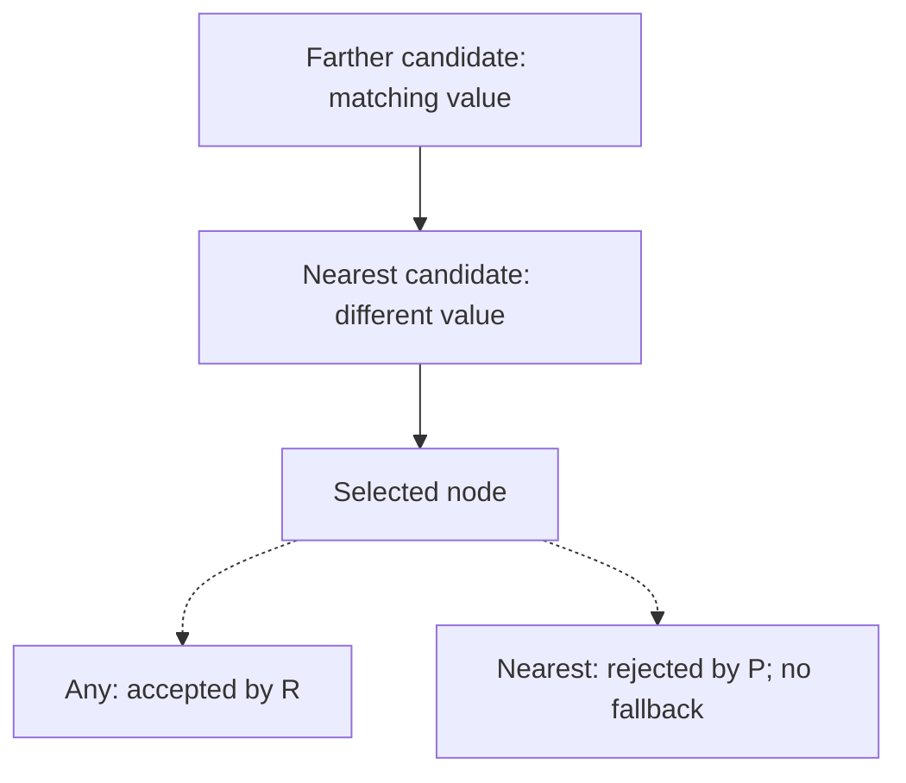

# Hierarchical query composition

The six composition methods build ordinary EF Core queries over the configured
hierarchy. They work on `NestedSet<TEntity>`,
`ScopedNestedSet<TEntity, TScope>`, and `NestedSetTree<TEntity, TTreeId>`.
They do not load an anchor, execute SQL, traverse CLR objects, or define domain
rules. Execute the finished query with `ToListAsync`, `SumAsync`, or another EF
terminal operation and pass its cancellation token.

Keep the normal entity mapping and the selected provider's callback registration,
for example `UseMySql(..., mysql => mysql.UseNestedSets())` from the `.MySql`
adapter. See [installation and registration migration](upgrading-provider-packages.md).
No additional model option, service, context property, or migration is required
for the composition contracts. The optional ancestor access path described
below is a separate schema optimization. Shadow, field-only, renamed, and converted structural roles
use the finalized mapping, including its identity comparison rules.

## Choose the operation

| Method | Meaning |
| --- | --- |
| `SelectSubtrees(anchors, projection)` | Each selected anchor with itself and its descendants |
| `SelectAncestors(nodes, projection)` | Each selected node with its strict ancestors |
| `SelectAncestorsOrSelf(nodes, projection)` | Each selected node with itself and its ancestors |
| `WherePathEdges(source, anchor, node, edgeAllowed)` | Keep rows whose complete visible downward path satisfies every direct edge |
| `WhereAnyAncestorOrSelf(source, node, predicate)` | Keep rows with any visible matching ancestor or self |
| `WhereNearestAncestorOrSelf(source, node, candidate, predicate)` | Choose the structurally nearest candidate first, then require its value predicate and complete visible path |

Projection parameters are `(source, related, distance)`. `distance` is the
mapped depth difference: zero for self and one for the direct parent or child.
Hidden intermediate nodes do not compress it. The methods add no presentation
ordering. Apply an explicit order to the final result.

Queries assume a valid persisted nested set, including `Left < Right`.
Complete-path checks establish visibility and direct-edge conditions within
that structure; they do not replace full validation or repair corrupt bounds.
Use `ValidateAsync` and `RebuildAsync` for those separate operations.

Every pair stays inside the same mapped hierarchy, Scope, and TreeId. A scoped
mapping requires `ForScope(...)`; `InTree(...)` additionally restricts the
whole composition to that tree. An unscoped hierarchy needs no Scope property.
NodeKeys need not be globally unique across scopes.

<a id="optional-selected-ancestor-access-path"></a>

## Selected ancestor access paths

Eligible strict `SelectAncestors` queries on Doka can bind their selected
structural source once and bound independent owners using the existing Right
index. This ordinary-model path uses the MySql adapter's directly bound public
source-binding and ordered-join APIs, but does not require `HasAncestorIndex()`
or a migration. Scalar selections and inspected independent fact selections can
qualify; correlated hierarchy selections and other adapters retain their
established paths.
Necessary source envelopes never replace exact Scope/TreeId, model visibility,
or the complete original containment checks on the final mapped aliases.

A second binding completes matched source/owner keys only on positively identified
MySQL, without removing repeated walk occurrences. MariaDB retains source-only
binding. Source payload uses an ordinary join
and final owner payload uses one directed edge on both routes. MySQL's extra
boundary separates optimizer search across repeated direction changes, but can
limit downstream predicate pushdown. Each binding
completes its own input once; distinct composition calls are not one globally
shared evaluation. The actual work and allocation cost still need measurement.

The model's [`HasAncestorIndex()` option](configuration.md#optional-ancestor-index)
adds a generated nonleaf flag and a deterministic additive index. It changes
the schema and requires a migration; the six composition APIs themselves do
not require it.

Use the [current capability and workload tables](configuration.md#optional-ancestor-index)
to decide whether the configured provider and source selection can use it.
The schema option alone does not activate an optimized read. Missing optional
provider capabilities retain the corresponding existing strategy; malformed
required API metadata fails clearly. No Doka runtime dependency is introduced.

The bounded and indexed strategies share selected structural input within one SQL statement attempt.
It preserves source occurrences, exact mapped endpoints, application/global
filters, complete tree identity, and final containment checks. It does not
cache results, perform construction I/O, prefetch an entity, or count input rows
to guess a plan. The final query still uses EF's ordinary async terminal,
cancellation, retries, and the application's database isolation.

Ordinary captured fact queries work with the recommended
provider-callback `UseNestedSets()` registration. For example, with an application-mapped
`Facts` set carrying `NodeId` and an already bound `tree`:

```csharp
var facts = context.Facts;
var owners = tree.SelectAncestorsOrSelf(
    node => facts.Any(fact => fact.NodeId == node.Id),
    (node, owner, distance) => new { Node = node.Id, Owner = owner.Id, Distance = distance });

var result = await owners.ToListAsync(cancellationToken);
```

No query source or getter is evaluated during construction. EF handles captured
values at the terminal; NestedSet then chooses the strategy from normalized
roots during compilation. Reassigning `facts` before the next terminal changes
the query source under EF's normal deferred rules. An independent fact root can
qualify for the optional reader, while a hierarchy-dependent filter, navigation,
raw SQL or opaque root keeps the established strategy. The
[configuration rules](configuration.md#current-query-capabilities) retain exact
model/filter checks and the model-only registration boundary. Captures do not
create a global request/context cache or change the result bag.
This normalization applies to all options-registered providers; the indexed
reader remains Doka-specific. Subsequent Path/Any/Nearest filters defer only
when their source already contains an owned marker, after their normal
immediate guards. They apply the existing proofs to the normalized source.
Some expression work therefore moves from `Build` into cold compilation.
A shorter builder does not establish lower complete-read cost or a warm-cache
speedup; measure both separately.

Read [implementation design](implementation-design.md#optional-ancestor-index-and-statement-local-source-binding)
for structural source boundaries, narrow candidate matching, and the two
local directed joins in the inclusive indexed path. Those mechanics do not provide result ordering, stronger
isolation, or a universal optimizer guarantee. In particular, consumer
`Any`/`Contains`/negated-existence predicates need their own native plans.
Use the [performance evidence](performance.md#optional-ancestor-index-and-shared-source-boundaries)
to compare complete reads against construction, write, and storage costs.
Application-owned fact and payload indexes remain part of that qualification.
The ancestor index does not index arbitrary domain filters, and efficient
hierarchy matching cannot prevent an unindexed consumer subquery from scanning
its own table.

## Project several subtrees in one query

Assume an ordinary mapped `Item` has `Id`, `TenantId`, and application fields
`Kind`, `Blocked`, and `Label`. These application fields are examples, not
requirements imposed by NestedSet.

```csharp
var hierarchy = context.NestedSet<Item>().ForScope(tenantId);

var pairs = hierarchy.SelectSubtrees(
    anchor => Enumerable.Contains(requestedIds, anchor.Id),
    (anchor, node, distance) => new
    {
        Anchor = anchor,
        Node = node,
        Distance = distance,
    });

var rows = await pairs
    .Where(row => row.Distance <= maximumDistance)
    .OrderBy(row => row.Anchor.Id)
    .ThenBy(row => row.Node.Id)
    .Select(row => new { AnchorId = row.Anchor.Id, NodeId = row.Node.Id, row.Distance })
    .ToListAsync(cancellationToken);
```

A node under two requested anchors contributes to both anchors. Repeated IDs
inside the anchor predicate do not duplicate the anchor source. An application
that needs repeated request rows joins those rows back to the projected pairs.
The library never inserts a global `Distinct` or chooses an aggregation grain.

Choose the selected endpoint to match the application's selective input. With
few payload owners under broad requested ancestors, select those unique owners
and use `SelectAncestorsOrSelf`, filter the requested ancestors, then join the
original payload back. This preserves repeated facts and overlapping ancestor
contributions without first constructing every unneeded descendant pair.
The [SignalLab query pipeline](../samples/SignalLab/Reporting/SignalReportBuilder.Query.cs)
shows that form; the [execution entry point](../samples/SignalLab/Reporting/SignalReportBuilder.cs)
owns its read snapshot and asynchronous terminal. Inspect native plans for the
actual data and provider; a later payload join does not guarantee early
predicate pushdown through an internal structural set operation.

SignalLab uses a fictional station/array/module/sensor network with freely
nested device classifications. Its pulse, sweep and burst inputs have distinct
physical fields and individual event identities; explicit projections normalize
them for aggregation. Equal-valued events still contribute independently. The
sample's channels, acquisition tags, connection windows and output matrix are
consumer code. NestedSet neither interprets those concepts nor requires their
tables or the sample's classification names.

## Prune complete branches

```csharp
var allowed = hierarchy.WherePathEdges(
    pairs,
    row => row.Anchor,
    row => row.Node,
    (row, parent, child) => !child.Blocked);

var rows = await allowed
    .Select(row => new { AnchorId = row.Anchor.Id, NodeId = row.Node.Id })
    .ToListAsync(cancellationToken);
```

`parent` and `child` always describe a stored direct parent-to-child edge,
including when the application originally found that path by looking upward.
The upper endpoint's incoming edge is excluded; the lower endpoint's incoming
edge is included. The empty self path has no edges, but both endpoints must
still be visible. A missing or filtered intermediate node rejects the path.

Temporal validity belongs to the application. For example, join facts to
`pairs` first and use the resulting row's measurement date in `edgeAllowed`:
require an applicable relation period for that exact direct edge. A closed
edge excludes its entire lower branch for that upper anchor. A lower anchor
can still report its own branch because its incoming edge is outside its path.
NestedSet does not infer effective dates, metadata inheritance, signal grain, or
authorization from structural bounds.

## Any and nearest have different contracts



```csharp
var any = hierarchy.WhereAnyAncestorOrSelf(
    pairs,
    row => row.Node,
    (row, owner) => owner.Kind == requestedKind && owner.Label == requestedLabel);

var nearest = hierarchy.WhereNearestAncestorOrSelf(
    pairs,
    row => row.Node,
    (row, owner) => owner.Kind == requestedKind,
    (row, owner) => owner.Label == requestedLabel);
```

`Any` is an existence filter over visible ancestors. It can match a visible
owner above a hidden intermediate node; it does not assert a visible path.
`Nearest` includes self as a candidate, selects by structural depth, and then
checks the chosen owner's value and complete visible owner-to-node path. A
rejected nearest owner, hidden intermediate node, or absent candidate yields
no row. There is no fallback to a farther matching owner or a default root key.

Put conditions that must hold on the **same owner** inside the same predicate.
Two independent calls can be satisfied by different owners. Candidate and value
predicates may depend on the incoming row. An additional `WherePathEdges`
retains its own temporal or business-edge rule; `Nearest` does not replace it.

## Look upward and choose a rank

```csharp
var ancestors = hierarchy.SelectAncestors(
    node => Enumerable.Contains(requestedIds, node.Id),
    (node, ancestor, distance) => new
    {
        Source = node,
        Ancestor = ancestor,
        Distance = distance,
    });

var directParents = ancestors.Where(row => row.Distance == 1);
var structuralNth = ancestors.Where(row => row.Distance == requestedDistance);
var matching = ancestors.Where(row => row.Ancestor.Kind == requestedKind);

var rows = await matching
    .Where(row => !matching.Any(closer =>
        closer.Source.Id == row.Source.Id && closer.Distance < row.Distance))
    .Select(row => new { SourceId = row.Source.Id, AncestorId = row.Ancestor.Id, row.Distance })
    .ToListAsync(cancellationToken);
```

This selects the first matching ancestor separately for each source. The n-th
matching ancestor instead counts qualifying closer ancestors per source and
requires that count to equal `rank - 1`. A global `Skip`/`Take` ranks the whole
result set and does not implement a per-source rule. Validate ranks in the
application before executing the query. Structural distance and matching rank
are deliberately separate concepts.

## Combine directions without losing origins

An upward result can supply anchors for a downward projection. Keep the
original rows and join the distinct anchor selection back to them:

```csharp
var up = ancestors.Where(row => row.Ancestor.Kind == requestedKind);

var down = hierarchy.SelectSubtrees(
    anchor => up.Any(row => row.Ancestor.Id == anchor.Id),
    (anchor, target, distance) => new
    {
        Pivot = anchor,
        Target = target,
        DownDistance = distance,
    });

var walks = up.Join(
    down,
    row => row.Ancestor.Id,
    row => row.Pivot.Id,
    (origin, destination) => new
    {
        Origin = origin.Source,
        Pivot = origin.Ancestor,
        destination.Target,
        UpDistance = origin.Distance,
        destination.DownDistance,
    });
```

This example binds one Scope, where the configured NodeKey is unique. For an
unbound external source, keep the complete mapped identity in application
joins. Do not join unrelated scopes using a bare local key.

The result is a bag of walks: two origins reaching one pivot remain two
origins; different pivots reaching the same target remain different walks.
Apply `Distinct` only after selecting the intended business grain. The same
rule holds for down-then-up, up-down-up, up-up, and down-down composition.
Two legs are not automatically collapsed into one transitive relationship.
Retain every intermediate endpoint and distance needed by later predicates.

Apply `WherePathEdges` separately to each required leg with its correct upper
and lower endpoint. A later open leg or self pair cannot restore a row removed
by an earlier blocked leg. A route may move above its original anchor unless
the application explicitly fences it, for example by comparing leg distances.

## EF boundaries and execution

- Endpoints must be existing mapped aliases selected from the same EF context.
  Anonymous projections and simple member initializers preserve these aliases;
  `new Item { Id = ... }` does not create a valid endpoint.
- A second named mapping with the same CLR type is still another mapping.
  Unrelated fact or metadata roots may remain ordinary payload in the query.
- `IEnumerable.AsQueryable()` is not a relational source and is rejected
  without enumerating it. Foreign-context and unsupported CLR predicates do not
  receive a client-side fallback. Some EF translation errors occur only at the
  terminal operation, before a database command is sent.
- A query hidden behind an object-typed carrier cannot prove bound-source
  visibility through a cast, type-as conversion or AsQueryable call. Captured
  query fields retain individual inspection; an opaque property getter cannot
  establish endpoint mapping. The guard does not execute application property
  getters to obtain that proof. Statically query-typed inputs remain supported;
  the rule does not reject ordinary object payloads.
- All hierarchy roots respect EF query filters. `IgnoreQueryFilters()` is an
  explicit application decision affecting the composed query; it never removes
  NestedSet's Scope or TreeId predicates. Filtered endpoints cannot be
  reconstructed from a local key belonging to another visible row.
- Final tracking policy applies to the complete query. Scalar DTOs and
  aggregates materialize no hierarchy entities. Entity-containing projections
  can track when the application selects `AsTracking()`; an already tracked
  instance retains its current CLR values. This is not a database refresh API.
- A scalar or aggregate terminal executes one composed statement. Additional
  collection includes and EF's `AsSplitQuery()` policy can require several
  statements, including for a single terminal. Several terminals are separate
  reads as well; use an adequate caller-owned transaction when they must share
  a read view. A `DbContext` never supports concurrent commands.

Composition starts no transaction and changes no isolation settings. One
statement does not strengthen the provider's configured read isolation.
Use the qualified [read-snapshot rules](transactions-and-locking.md#read-consistency)
when the result must remain consistent with concurrent structural writers.

Query construction allocates expression nodes proportional to the expression
shape, not to the stored tree size. It does not retain a materialized tree.
Result memory depends on the application's projection and buffering. Path and
nearest-owner checks still have data-dependent database costs: use the
[performance guide](performance.md), actual plans, and a representative result
cardinality rather than treating nested sets as constant-cost queries.

The [SignalLab](../samples/SignalLab/README.md) and
[UserGroups](../samples/UserGroups/README.md) samples demonstrate domain-specific
temporal paths, metadata filters, role selection, reduction, and bounded chains.
Those policies remain outside the library.

## Primary-source boundaries

Collection predicates over captured arrays use explicit `Enumerable.Contains(ids, node.Id)`.
C# 14 can otherwise bind array extension calls to `MemoryExtensions.Contains`,
introducing a span into the expression tree. EF Core 10 normalizes that pattern,
but explicit binding also keeps the predicate compatible with expression
interpretation before EF processes it. Retain `EF.Parameter(ids)` inside the
first argument when a query requires the provider's collection parameter policy.
Membership in an `IQueryable` subquery continues to use `Queryable.Contains`.
See Microsoft's [C# 14 overload-resolution change](https://learn.microsoft.com/en-us/dotnet/core/compatibility/core-libraries/10.0/csharp-overload-resolution).

NestedSet defines the structural contracts above. EF defines expression
translation, filters, tracking, and async execution:

- [EF complex query operators](https://learn.microsoft.com/en-us/ef/core/querying/complex-query-operators)
  explains provider-dependent translation and why a correlated inner `Where`
  can translate to a join while other correlated forms require `APPLY`.
- [EF query filters](https://learn.microsoft.com/en-us/ef/core/querying/filters)
  defines explicit filter opt-out.
- [EF tracking](https://learn.microsoft.com/en-us/ef/core/querying/tracking)
  defines entity identity resolution and tracking of entity-containing results.
- [EF single and split queries](https://learn.microsoft.com/en-us/ef/core/querying/single-split-queries)
  defines collection loading and its multiple-statement boundary.
- [EF asynchronous programming](https://learn.microsoft.com/en-us/ef/core/miscellaneous/async)
  distinguishes expression-building operators from async terminal operations.

These sources explain EF behavior. They do not certify NestedSet semantics,
provider plans, allocation budgets, or an unexecuted CI run; those require the
repository's actual regression and qualification evidence.
