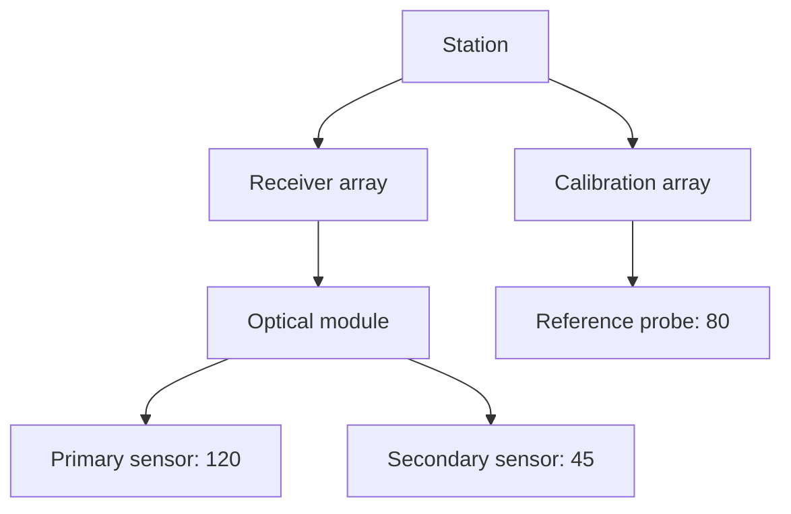
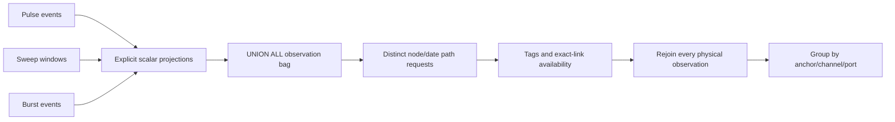
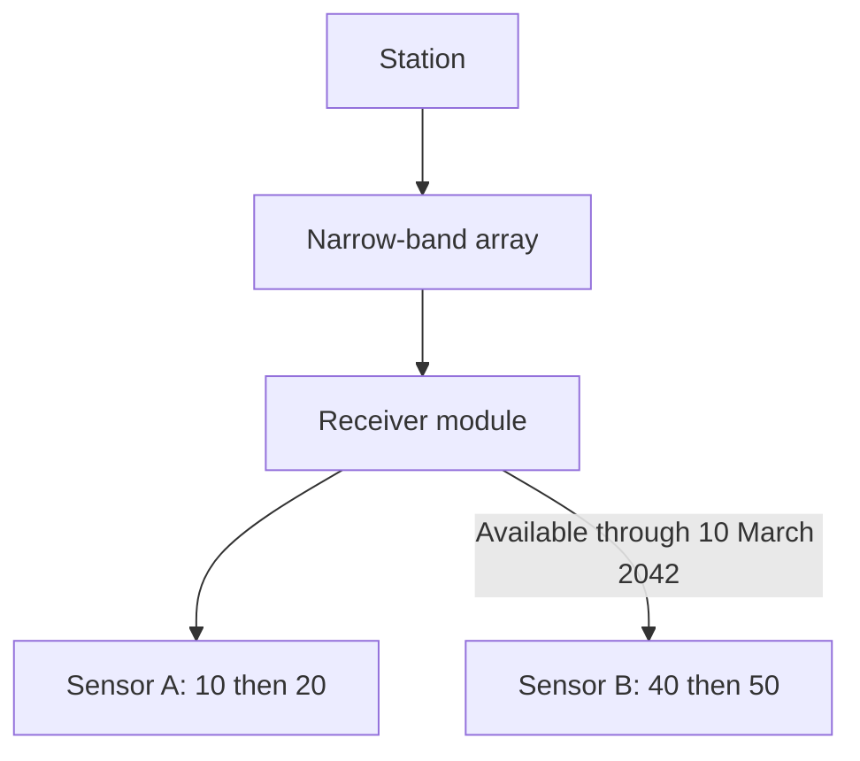

# SignalLab sample

SignalLab is a fictional acquisition laboratory. Its station, array, module and
sensor names, tag catalog, future observation epoch and deterministic identities
are invented for this repository. They describe no organization, person or
application database. NestedSet supplies generic hierarchy operations; the
laboratory chooses its own acquisition formats and aggregation rules.
Node and channel keys are deterministic. Each dataset invocation allocates a
fresh synthetic isolation-tenant key so repeated scenarios can coexist in one
database without sharing their control catalogs.

The executable contains eight independently startable scenarios. The first four
show mapping, ordering and ordinary tracked payload updates. The other four show
scalar acquisition queries over three different physical input formats. They
use the same public hierarchy API and retain readable before/after output.

## Run from the repository root

The default provider is Doka with MariaDB 11.8:

```sh
docker compose -f docker/compose.yml --profile mariadb up --build --wait --wait-timeout 180
docker compose -f docker/compose.yml exec -T mariadb bash -s < docker/provision-samples.sh
dotnet run --project samples/SignalLab -- --scenario aggregate
```

For MySQL, select its existing developer service and the same Doka migration set:

```sh
docker compose -f docker/compose.yml --profile mysql up --build --wait --wait-timeout 180
docker compose -f docker/compose.yml exec -T mysql bash -s < docker/provision-samples.sh
dotnet run --project samples/SignalLab -- --provider mysql --scenario report
```

SQLite requires no container:

```sh
dotnet run --project samples/SignalLab -- --provider sqlite --scenario report
```

The owned database is `nestedset_sample_signal_lab`; the SQLite filename is
`nestedset_sample_signal_lab.sqlite` under `artifacts/samples` by default.
`NESTEDSET_SAMPLE_CONNECTION_STRING` selects another MySQL/MariaDB endpoint, but
its database must be omitted or exactly this owned name. Other database names
are rejected before access or reset. `NESTEDSET_SAMPLE_SQLITE_DIRECTORY` changes
the local directory while retaining the fixed filename. Connection strings and
passwords are not printed. See [Docker setup](../../docker/README.md).

## Repeat and inspect

The first run applies ordinary EF migrations and seeds the selected scenario
through public NestedSet APIs. SafeMigrations is optional and is not needed.
Each scenario uses its own deterministic station trees and a fresh context.
A normal start rejects an initialized sample database instead of appending data.

```sh
# Run all eight flows against a new sample database.
dotnet run --project samples/SignalLab -- --reset

# Recreate only this sample's database and select one flow.
dotnet run --project samples/SignalLab -- --provider sqlite --reset --scenario nearest

# Inspect retained data without migrations, seeding or writes.
dotnet run --project samples/SignalLab -- --provider sqlite --inspect --details

# Print usage without opening a database.
dotnet run --project samples/SignalLab -- --help
```

`--reset` deletes only the sample-owned database, including other scenarios kept
there. Inspection cannot be combined with reset or execution. Ctrl+C requests
cooperative cancellation. A failed or canceled run retains committed state for
inspection. Exit codes are 0 for checked success, 1 for invalid input/failure,
and 130 for cancellation. `--details` prints keys, depth, position and bounds.

| Scenario | Operation | Checked result |
| --- | --- | --- |
| `aggregate` | Sum sensor-leaf counters using a scoped descendant query. | Receiver array totals 165; the station totals 245. |
| `order` | Place the calibration array before the receiver array. | Positions become 0 and 1; the total remains 245. |
| `update` | Change the primary sensor through an ordinary `DbSet` and `SaveChangesAsync`. | Its counter becomes 150; receiver array totals 195 and station totals 275. |
| `rejected` | Attempt to move an array below its own sensor. | `CycleDetected`; structural values remain unchanged. |
| `report` | Query four overlapping anchors, two channels and three acquisition ports. | The station's pulse-port primary channel totals 70; Sensor A totals 30. |
| `temporal` | Check every exact instrument link at the observation date. | On 11 March 2042 the station receives A's 20; a direct anchor on B still receives B's 50. |
| `metadata` | Combine band, module class and same-sensor tags. | Narrow/Receiver/(Liquid AND R7) totals 70; Wide has no matching observation. |
| `nearest` | Select any or the nearest structurally eligible tag owner. | Any Receiver accepts P's 10; nearest Receiver rejects behind Relay; nearest Relay accepts. |

## Explicit instrument mapping

[Instrument](Domain/Instrument.cs) deliberately uses customized structural
property names rather than an interface or base entity:

```csharp
builder.HasNestedSet(node => node
    .HasNodeKey(instrument => instrument.NodeId)
    .HasBounds(instrument => instrument.Start, instrument => instrument.End)
    .HasDepth(instrument => instrument.Level)
    .HasPosition(instrument => instrument.SiblingPosition)
    .HasTreeId(instrument => instrument.TreeId)
    .HasScope(instrument => instrument.ProjectId)
    .HasParent(instrument => instrument.ParentInstrumentId));
```

`ProjectId` is an application-owned laboratory partition, not a required Project
entity. A different laboratory deliberately reuses `TreeId`; another station
uses a different `TreeId` inside the same laboratory. Neither can contribute to
the selected station. The parent foreign key also includes `ProjectId`.
Applications without partitions can omit scope configuration, as in the
[FileSystem sample](../FileSystem/README.md).



Only sensor leaves carry a counter in these basic scenarios. Containers have no
stored total. The leaf sum is application policy, independent of the NestedSet
storage model:

```csharp
var instruments = context.NestedSet<Instrument>().ForScope(laboratoryId);
var pulses = await instruments.DescendantsOf(arrayId)
    .Where(instrument => instrument.End == instrument.Start + 1)
    .SumAsync(instrument => instrument.PulseCount ?? 0, cancellationToken);
```

No `OrderBy` is configured, so the explicit move operations control sibling
position. Ordinary tracked changes update `Title` and `PulseCount` without
changing the structural parent or position. The optional `NestedSetDbContext`
base coordinates `SaveChangesAsync`; [UserGroups](../UserGroups/README.md) shows
composition with an existing context override instead.

## Independent acquisition formats

[SignalNode](Domain/Reporting/SignalNode.cs) holds only instrument payload. Tree,
parent, left/right bounds, depth and position are shadow properties named by
[SignalStorage](Domain/Reporting/SignalStorage.cs). Instrument kinds are separate
from depth: nested modules and sensors deliberately repeat on a path.

The acquisition inputs are physically different. The query normalizes them with
three explicit scalar projections before `Concat`/SQL `UNION ALL`:

| Port | Native identity and fields | Normalized interpretation |
| --- | --- | --- |
| Pulse | `Sequence`, `NodeId`, `ChannelId`, `Granularity`, `Day`, `PulseCount` | One pulse-counter event. |
| Sweep | `Sequence`, `ReceiverId`, `StreamId`, `Resolution`, `CompletedOn`, `IntegratedTicks` | One completed integration window. |
| Burst | `Sequence`, `DeviceId`, `SignalId`, `BucketSize`, `CapturedOn`, `Magnitude` | One device burst. |

Each relation also includes `TenantId`. A storage-generated `Sequence` identifies
an event independently of its value and observation grain. Two equal-valued
events at the same node/channel/date remain two events. The nonunique analytical
lookup index supports the tenant/channel/node/grain/date predicates; it does not
turn that grain into an event identity. Tenant-qualified foreign keys prevent
cross-laboratory channel or instrument references.



The fixed epoch begins on 10 March 2042. These invented counts are additive only
within the requested channel and acquisition grain. Coarse records and records
on the wrong instrument kind deliberately exist and are excluded. Other units
or nonadditive values would require different application rules.

### Fixture checks and real measurements

The console checks data availability separately from the expected numeric total.
`HasData = false` means no qualifying observations; a measured zero remains
`HasData = true` with a value of zero. An absent expectation never causes a
numeric comparison.

The fixed fixture uses small integer inputs such as 10, 20, 40 and 50, with
integer multipliers and sums that remain exactly representable in `double`.
Its exact equality check deliberately rejects every deviation. The local Rider
suppression documents this fixture-specific assumption; it is not a general
comparison policy for measurements.

Real measurement calculations require an explicit comparison policy based on
the channel's unit, acquisition precision, value scale and aggregation error.
Choose absolute and/or relative tolerances from those requirements and define
how nonfinite values (`NaN` and infinities) are handled. Keep data availability
independent of that policy. `double.Epsilon` is not a general rounding
tolerance, and changing `==` to `.Equals()` does not provide approximate equality.
See Microsoft's [floating-point comparison guidance](https://learn.microsoft.com/en-us/dotnet/api/system.double.equals?view=net-10.0#precision-in-comparisons).

## Links, tags and anchor semantics

`LinkWindow` records inclusive availability for an exact parent/child link. A
missing or closed intermediate link rejects the full contribution to the
selected upper anchor. An unrelated ancestor relation cannot bypass that link.
The incoming link of the selected anchor is outside its own checked path.



The sample uses fixed case-sensitive codes:

- Array `Band`: `Narrow` or `Wide`.
- Module `ModuleClass`: `Receiver` or `Relay`.
- Sensor `Cooling`: `Liquid` or `Air`.
- Sensor `RackCode`: `R7` or `R9`.
- Sensor `CaptureMode`: `Continuous` or `Triggered`.

Filters for different kinds are AND-combined. Multiple fields for one kind must
match on the same owner. `Any` accepts a matching ancestor or self. `Nearest`
first chooses the structurally nearest owner of the required kind, then tests
its values; a mismatch does not fall back to a more distant matching owner.
The repeated-kind scenario also rejects combining one sensor's cooling tag
with another sensor's rack code.

An anchor is a structural subtree selection. Overlapping anchors each retain
their own result identity, even when the same physical event contributes to
both. Adding those totals together would double-count shared subtrees; the
sample never treats that as a whole-tree total.

## Deferred query and bounded result handling

[SignalReportBuilder](Reporting/SignalReportBuilder.cs) builds ordinary deferred
EF expressions. Construction performs no database access. One read owns a
validated snapshot of selections and executes one scalar catalog reader and
one scalar aggregate reader within the existing consistent-read boundary.
Unknown channels/anchors/tags, invalid ranges, contradictory tag rules and
cross-scope selections fail without partial results.

The scalar path proof is keyed by anchor, measured node and date, independently
of channel and port. Qualifying that unique grain before rejoining the
original observation bag avoids repeating expensive path decisions for each
independent channel/port event. It never deduplicates physical observations or
equal-valued events. Measurements and hierarchy entities are not materialized
by the report query.

The final matrix preserves requested anchor/channel/port order and distinguishes
an absent group from a measured zero. Dense and sparse readers retain complete
tuple validation, duplicate rejection, checked size arithmetic, cancellation,
EOF and disposal behavior. Selection order does not alter SQL identity or
nearest-owner semantics. The sample introduces no generic report framework or
size policy into NestedSet.

## Migrations and verification

Each provider has two checked-in synthetic schema stages:

1. `InitialInstruments` creates the basic instrument hierarchy and its tree
   registry.
2. `SignalAcquisition` adds instrument kinds, tags, link windows, channel catalog
   and the three heterogeneous event relations.

These migrations belong to the sample's owned database. They are not a migration
path from any other application's schema. Inspection does not apply a pending
stage; it can inspect basic instrument data before acquisition tables exist.
Tests cover a fresh database and an upgrade that preserves earlier instrument
rows, maintained coordinates and migration history.

Unit tests exercise construction, request ownership, readers and allocation
contracts. Shared provider tests execute the same acquisition logic against
native database providers and compare an independent adjacency oracle.
Benchmarks measure the real sample builders and an independently composed LINQ
reference on identical prepared data. Generated SQL work, broad/deep trees and
materialization controls retain separate evidence boundaries.

See the [regression map](../../docs/query-composition-regression-coverage.md),
[performance guide](../../docs/performance.md) and
[measurement qualification](../../docs/qualification/query-performance.md) for
source references and the exact scope of measured evidence. Historical figures
are not measurements of this redesigned model unless explicitly requalified.
