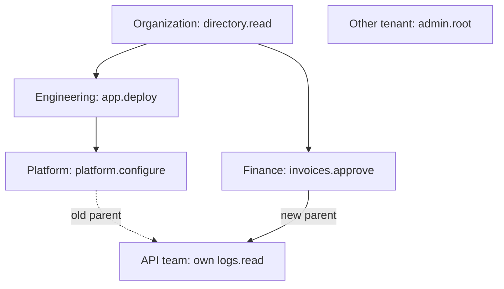
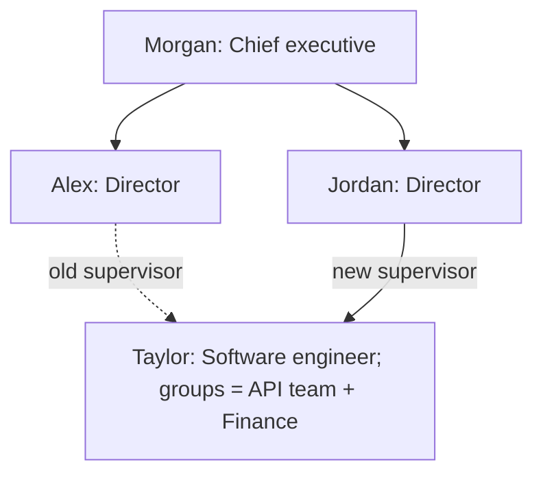
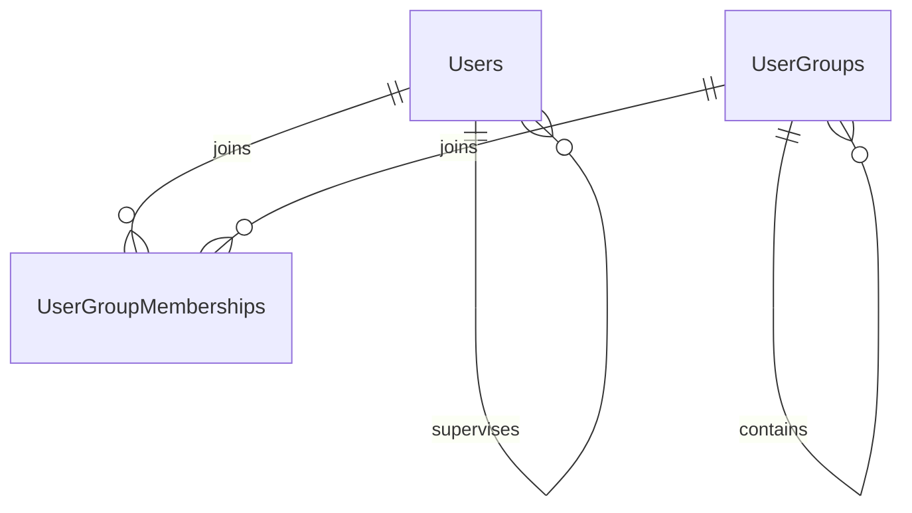
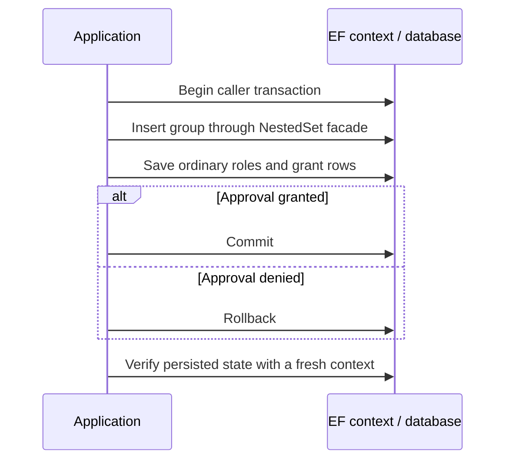

# User groups, users, roles and inherited privileges

This standalone console sample demonstrates two tenant-scoped hierarchies: groups with application-defined inherited
privileges, and users arranged by supervisor. A user can have zero or several groups in the same tenant; moving a user
beneath a different supervisor does not change those memberships or their grants. The sample uses the Doka provider
with MariaDB 11.8 by default; MySQL 8.4 and persistent SQLite are optional routes.

Here `User` represents a tenant-owned employee, not a global sign-in identity. Its visible `TenantId` names that ownership
and participates in the supervisor and membership foreign keys. If one sign-in identity can join several tenants,
model that identity separately from its tenant memberships and employee hierarchy nodes. EF Core documents the
[tenant discriminator column](https://learn.microsoft.com/en-us/ef/core/miscellaneous/multitenancy), while Microsoft's
[identity guidance](https://learn.microsoft.com/en-us/azure/architecture/guide/multitenant/approaches/identity#user-and-tenant-conflation)
explains why a user identity and a tenant must not be conflated.

The sample's application rule is explicit: a group receives the union of privileges from its own roles and its ancestors'
roles. Moving a group changes the inherited grants while keeping its direct assignments. This rule is implemented in
[PrivilegeQueries.cs](Queries/PrivilegeQueries.cs), not by NestedSet itself. A user's effective privileges are the
distinct union of grants inherited through every directly assigned group. There are no deny or override rules.

The multi-table queries in [PrivilegeQueries.cs](Queries/PrivilegeQueries.cs),
[GroupOutput.cs](Output/GroupOutput.cs), and [SupervisorOutput.cs](Output/SupervisorOutput.cs) use LINQ method syntax.
Equivalent query-syntax forms remain commented beside them for comparison; both forms retain the same tenant keys,
filters, projections, and ordering.

## Run from the repository root

Start the optional developer database once:

```sh
docker compose -f docker/compose.yml --profile mariadb up --build --wait --wait-timeout 180
docker compose -f docker/compose.yml exec -T mariadb bash -s < docker/provision-samples.sh
dotnet run --project samples/UserGroups/UserGroups.csproj -c Release
```

The first invocation applies the checked-in migration chain and runs all nine scenarios. Results remain in
`nestedset_sample_usergroups`, including after the process exits. Open that database in Rider using the connection
settings in the [Docker guide](../../docker/README.md). Each scenario owns a separate tenant key and tree so its expected
result does not depend on another scenario running first.

```sh
dotnet run --project samples/UserGroups/UserGroups.csproj -c Release -- --inspect
dotnet run --project samples/UserGroups/UserGroups.csproj -c Release -- --inspect --details
dotnet run --project samples/UserGroups/UserGroups.csproj -c Release -- --reset --scenario inheritance
dotnet run --project samples/UserGroups/UserGroups.csproj -c Release -- --provider mysql --scenario commit
dotnet run --project samples/UserGroups/UserGroups.csproj -c Release -- --provider sqlite --scenario rollback
dotnet run --project samples/UserGroups/UserGroups.csproj -c Release -- --provider sqlite --scenario supervisors
dotnet run --project samples/UserGroups/UserGroups.csproj -c Release -- --help
```

Inspection performs only reads. The normal start rejects a prior initialized database, including a partial failed run,
and explains how to inspect or reset it. `--reset` deletes and recreates **only** this sample's fixed database before
running the selected scenario. A connection-string override naming another database is rejected before reset. No
automatic cleanup occurs after success or failure.

Inspection refuses an older schema instead of applying migrations as a side effect. Each provider retains its released
initial migration and adds one coherent migration for group-derived supervisor searches. A local database created from
an earlier unpublished intermediate migration has no supported in-place upgrade path; keep its data separately or use
`--reset` only when intentionally discarding that sample database.

The default SQLite file is `artifacts/samples/nestedset_sample_usergroups.sqlite`, relative to the working directory.
`NESTEDSET_SAMPLE_SQLITE_DIRECTORY` changes its parent directory. Use `NESTEDSET_SAMPLE_CONNECTION_STRING` for a server
endpoint override, omitting `Database` or setting it to `nestedset_sample_usergroups`. See the [sample catalog](../README.md)
for the shared provider and database setup. Ctrl+C propagates cancellation through database calls; success returns exit
code 0, errors return 1, and cancellation returns 130.

## Select a readable workflow

| Scenario | Visible application operation | Verified result |
| --- | --- | --- |
| `inheritance` | Move the API team from Platform to Finance; save a tracked payload rename. | Own `logs.read` remains, ancestor grants change, another tenant's `admin.root` is excluded, and the existing timestamp customization runs. |
| `commit` | Create an organization and team, then assign a role and privilege inside one caller transaction. | The hierarchy and every ordinary grant row are visible from a fresh context after commit. |
| `rollback` | Add provisional access under Finance, save the role data, then deny approval. | Rollback preserves every original parent and coordinate; no provisional group, role, permission, assignment or grant remains. |
| `rejected` | Attempt to move Engineering below its descendant API team. | `CycleDetected` is handled explicitly and the complete persisted structure remains unchanged. |
| `supervisors` | Give Taylor two groups and Morgan none, build a separate supervisor tree, filter ancestors by a business `Position`, then move Taylor beneath another director. | The reporting line and hidden bounds change; Taylor keeps both `logs.read` and `invoices.read` while Morgan has no group-derived grants. |

The original mutation scenarios finish with full validation of their trees. The new query scenarios verify their exact
expected candidates, ranks, chain outcomes, and provenance. Normal output shows small indented trees and specific results;
`--details` adds tenant/tree identities, node keys, parents, depth, position, and boundaries. Generated group/role keys and
UTC timestamps can differ between runs; the selected names, relationships, expected permission codes, and tree identities
are fixed by the scenario.

The inheritance workflow starts with:

```text
Organization              Member -> directory.read
  Engineering             Engineer -> app.deploy
    Platform              Platform maintainer -> platform.configure
      API team            Auditor -> logs.read
  Finance                 Billing approver -> invoices.approve
```

Before the move, the API team receives:

```text
app.deploy, directory.read, logs.read, platform.configure
```

After moving it below Finance:

```text
Organization
  Engineering
    Platform
  Finance
    API team

directory.read, invoices.approve, logs.read
```



The unrelated tenant deliberately uses the same `TreeId`. The `TenantId` scope keeps the trees isolated. The privilege
query also applies the tenant key to the ordinary role and grant tables, and their composite foreign keys prevent
persisting a relationship between endpoints from different tenants. Tenant selection is an application responsibility;
a hierarchy scope itself is not an authorization check.

The `supervisors` workflow adds a second NestedSet mapping in the same context:

```text
Morgan - Chief executive (groups: none)
  Alex - Director (groups: Engineering)
    Taylor - Software engineer (groups: API team, Finance)
  Jordan - Director (groups: Finance)
```

After moving Taylor beneath Jordan, `AncestorsOf(taylorId).Where(user => user.Position == "Director")` finds Jordan
without loading Taylor first. Taylor remains in both API team and Finance and retains their distinct `logs.read` and
`invoices.read` grants. Morgan has no groups and therefore no group-derived grants. Supervisor ancestry is not treated
as a privilege source.





## Configuration remains ordinary EF code

[UserGroup](Entities/UserGroup.cs) is a plain entity with no required NestedSet interface or base type. `TenantId` is a
simple scope value; no additional tenant or tree entity is required. [UserGroupConfiguration](Data/Configurations/UserGroupConfiguration.cs)
implements `IEntityTypeConfiguration<UserGroup>` and explicitly selects `Id`, `TenantId`, `TreeId`, `ParentId`,
`Left`, `Right`, `Depth`, and `Position`. This sample uses manually maintained sibling order; the FileSystem sample
demonstrates configured alphabetical ordering.

[User](Entities/User.cs) is also a plain entity. Its public `Position` is a job title such as `Director`. The technical
`TreeId`, `Left`, `Right`, and `NestedSetPosition` values are **shadow properties**: they exist in the EF model and
database, not as CLR members of `User`. [UserConfiguration](Data/Configurations/UserConfiguration.cs) declares the tree
identity as `Guid` and the three coordinates as `long` before selecting them by name:

```csharp
builder.Property<Guid>(UserHierarchyProperties.TreeId);
builder.Property<long>(UserHierarchyProperties.Left);
builder.Property<long>(UserHierarchyProperties.Right);
builder.Property<long>(UserHierarchyProperties.NestedSetPosition);

builder.HasNestedSet(node => node
    .HasNodeKey(user => user.Id)
    .HasScope(user => user.TenantId)
    .HasTreeId(UserHierarchyProperties.TreeId)
    .HasParent(user => user.SupervisorId)
    .HasBounds(UserHierarchyProperties.Left, UserHierarchyProperties.Right)
    .HasDepth(user => user.Depth)
    .HasPosition(UserHierarchyProperties.NestedSetPosition));
```

The same-tenant supervisor foreign key and the two [membership](Entities/UserGroupMembership.cs) foreign keys are
configured separately. The membership key `(TenantId, UserId, UserGroupId)` prevents duplicates; composite foreign keys
ensure both endpoints belong to the same tenant. User deletion cascades to memberships, while group deletion with
memberships requires an explicit application decision. This uses EF Core's
[direct join-entity pattern](https://learn.microsoft.com/en-us/ef/core/modeling/relationships/many-to-many#direct-use-of-join-table)
without collection navigations on every user or group. Queries can refer to a shadow coordinate with
`EF.Property<long>(user, UserHierarchyProperties.Left)` while EF translates the query. Inspection projects
`EF.Property<Guid>(user, UserHierarchyProperties.TreeId)` to select each stored tree without tracking users. A detached
user instance has no CLR tree identity or coordinates to read. Inserting a root still requires an explicit tree ID, and
`InTree(treeId)` still distinguishes trees. This follows
[EF Core's shadow-property contract](https://learn.microsoft.com/en-us/ef/core/modeling/shadow-properties).

After inserting a user and a group, ordinary EF operations manage each association independently:

```csharp
context.UserGroupMemberships.Add(new UserGroupMembership
{
    TenantId = tenantId,
    UserId = user.Id,
    UserGroupId = group.Id,
});
await context.SaveChangesAsync(cancellationToken);
```

Add another row for another group. Removing one membership removes only that association; it does not move the user in
the supervisor tree or remove the user or group.

[UserGroupContext](Data/UserGroupContext.cs) derives directly from `DbContext` and exposes normal `DbSet` properties:

```csharp
public DbSet<UserGroup> Groups => Set<UserGroup>();
public DbSet<User> Users => Set<User>();
public DbSet<UserGroupMembership> UserGroupMemberships => Set<UserGroupMembership>();
public DbSet<Role> Roles => Set<Role>();
```

Its existing UTC timestamp policy remains in `SaveChangesAsync`. The override composes the public coordinator with the
application's base save instead of requiring the optional `NestedSetDbContext` base class:

```csharp
StampUpdatedPayloads();

return this.SaveNestedSetChangesAsync(
    acceptAllChangesOnSuccess,
    token => base.SaveChangesAsync(false, token),
    cancellationToken);
```

The token-only EF overload dispatches to this override. The synchronous overrides preserve EF's explicitly synchronous
API while rejecting changes that require asynchronous hierarchy coordination. All sample workflows use asynchronous
calls with their cancellation token.

Registration is `options.UseMySql(..., mysql => mysql.UseNestedSets())` through `.MySql` and
`options.UseSqlite(..., sqlite => sqlite.UseNestedSets())` through `.Sqlite`, visible in [SampleDatabaseConfiguration](../Shared/SampleDatabaseConfiguration.cs). Entity configuration is discovered by
`ApplyConfigurationsFromAssembly`. Normal tracked payload changes use `Groups` or `Users` and `SaveChangesAsync`;
creating or moving hierarchy nodes uses `context.NestedSet<UserGroup>().ForScope(tenantId)` or
`context.NestedSet<User>().ForScope(tenantId)`.

The group effective-grant query starts from a group ID without first loading that entity. The user query starts from
`UserId`, joins every membership to its group, and selects that group's own and ancestor grants within its `TenantId`
and `TreeId`. The role/grant filters, duplicate removal, and sort remain in SQL until `ToListAsync` executes the query.
Supervisor output reads the tree in preorder and fetches group names in one additional query, so an unassigned user
still appears exactly once and a user with multiple groups is not duplicated.

## A transaction belongs to the application



[CommitScenario](Scenarios/CommitScenario.cs) uses `ReadCommitted` on Doka; SQLite uses `Serializable` because its
writer-coordination contract differs. [RollbackScenario](Scenarios/RollbackScenario.cs) disposes the context belonging to
the rolled-back operation before checking persisted state. A caller rollback does not rewind CLR instances or EF tracker
entries; there is no global `ChangeTracker.Clear()` that could discard another operation's work.

Roles, privileges, assignments, and grants are mapped in separate [configuration files](Data/Configurations/). These
entities stay ordinary EF data. They are not inserted through a hierarchy service and are not coupled to an additional
sample runner abstraction.

## Migrations and indexes

The Doka and SQLite contexts share the same application model. Each preserves its checked-in `InitialUserGroups`
migration and adds one `GroupSupervisorQueries` migration under `Migrations/MySql` and `Migrations/Sqlite`.
`UserGroupSqliteContext` selects the SQLite migration chain; it is
a provider-routing type rather than a required application base class. The design-time factories construct options
without connecting, migrating, seeding, or resetting a database.

The feature migration explicitly keeps existing users, groups, roles, and
memberships visible, with equal membership priority `0`. Existing groups remain
unclassified and existing memberships retain unrestricted dates. The
[provider migration regressions](../../tests/Doka.EntityFrameworkCore.NestedSet.Specification.Tests/Integration/Samples/UserGroups/GroupSupervisorTests.Migrations.cs)
check fresh schema creation, preservation of old coordinates and grants, and
the actual sample scenario against the migrated Doka and SQLite schemas.

Each initial migration creates the group and supervisor trees, their separate registries, roles, privileges, and the
user-to-group join table together. The public business `User.Position` maps as text; the shadow
`User.NestedSetPosition` maps as `long` and participates in the derived
`(TenantId, TreeId, SupervisorId, NestedSetPosition)` sibling index. The join primary key supports user-to-group lookup;
`(TenantId, UserGroupId, UserId)` supports the reverse direction. There is no scalar `Users.UserGroupId` in this schema.
EF Core's [migration guidance](https://learn.microsoft.com/en-us/ef/core/managing-schemas/migrations/managing)
describes removing unpublished migrations and scaffolding the current model again.

`HasNestedSet` contributes its registry and deterministic structural indexes to normal EF metadata and migration
generation. For these scoped models, the relevant query indexes begin with `TenantId` and cover `TreeId/Left`,
`TreeId/Right`, and each model's parent and sibling-position columns: `ParentId/Position` for groups and
`SupervisorId/NestedSetPosition` for users. The ordinary grant relationships contribute their own keys and foreign-key
indexes. SafeMigrations is optional and is not required to run this sample or apply these migrations.

The sample uses `MigrateAsync` throughout; it does not mix migration-owned schemas with `EnsureCreated`. Further details
are in the repository's [migration guide](../../docs/migrations.md) and
[transaction contract](../../docs/transactions-and-locking.md).

## Group-derived supervisor queries

The four additional console scenarios use the same ordinary `Groups`, `Users`, and
`UserGroupMemberships` sets. They add application classifications, exact membership
roles, optional tenant-wide user roles, typed routing values, and direct-edge
validity periods. NestedSet itself contains no user, role, or supervisor policy.
The direct `User.SupervisorId` hierarchy above remains an independent example.

```sh
dotnet run --project samples/UserGroups/UserGroups.csproj -c Release -- --provider sqlite --reset --scenario team-supervisors
dotnet run --project samples/UserGroups/UserGroups.csproj -c Release -- --provider sqlite --reset --scenario group-level-supervisors
dotnet run --project samples/UserGroups/UserGroups.csproj -c Release -- --provider sqlite --reset --scenario ancestor-selection
dotnet run --project samples/UserGroups/UserGroups.csproj -c Release -- --provider sqlite --reset --scenario supervisor-chain
```

| Scenario | Explicit consumer choice |
| --- | --- |
| `team-supervisors` | Include the own team or start above it; local, global, or either role; retain every origin, report ambiguity, or choose a unique business priority. |
| `group-level-supervisors` | Find a group by application `TypeId` and exact routing owners; distinguish the first eligible group from selecting a type group before validating its people. |
| `ancestor-selection` | Contrast structural distance, eligible group number, and person rank. Two leads in one group count as one group and two people. |
| `supervisor-chain` | Advance strictly above the previous found group, or explicitly expand every membership of the selected person; retain initial routing or use the current subject. |

Output uses the shared fixture names, for example `Anna/G4 -> Ben/G2`, and labels each origin separately.
The group-path/type legend explains these labels before each workflow. `--details` adds the actual keys,
tenant/tree identities, and original/current hop provenance; rendering performs no additional database lookups.

A search starts from a user key; it does not load the user or the start groups first:

```csharp
var request = new SupervisorRequest
{
    SourceUserId = userId,
    StartGroupId = null, // Every visible own membership, retaining separate origins.
    SearchStart = SearchStart.ParentsOnly,
    Roles = new EitherRole(managerRoleId),
    Groups = new NthEligibleGroup([], 1),
    Matches =
    [
        new MetadataMatch(
            MetadataOwner.SourceUser, "Route",
            MetadataOwner.CandidateMembership, "Route"),
    ],
    OnDay = new DateOnly(2026, 10, 16),
};

var deferred = SupervisorQueries.Candidates(context, tenantId, request);
var result = await SupervisorQueries.ResolveAsync(
    context, tenantId, request,
    SupervisorSelection.RequireUnique, cancellationToken);
```

The [main partial](Queries/Supervisors/SupervisorQueries.cs) exposes candidates,
resolution and both chain workflows. Their implementation remains in the same
type, organized by responsibility:

| Source | Responsibility |
| --- | --- |
| [Candidates](Queries/Supervisors/SupervisorQueries.Candidates.cs) | Compose visible origins, group windows, memberships and routing sources. |
| [Resolution](Queries/Supervisors/SupervisorQueries.Resolve.cs) and [ranking](Queries/Supervisors/SupervisorQueries.Ranking.cs) | Build scalar status/evidence rows and server-selected person witnesses. |
| [Fixed projections](Queries/Supervisors/SupervisorQueries.Projections.cs) | Share immutable key, path, aggregate and result expressions without retaining request values or query roots. |
| [Execution](Queries/Supervisors/SupervisorQueries.Execution.cs) | Read the scalar query asynchronously and reconstruct complete outcomes. |
| [Chains](Queries/Supervisors/SupervisorQueries.Chains.cs) and [transport](Queries/Supervisors/SupervisorQueries.ChainTransport.cs) | Advance logical frontiers and execute bounded physical batches. |
| [Branch decisions](Queries/Supervisors/SupervisorQueries.ChainBranches.cs) and [state](Queries/Supervisors/SupervisorQueries.ChainState.cs) | Preserve per-path provenance, cycle detection and physical/logical budgets. |
| [Models](Queries/Supervisors/SupervisorQueries.Models.cs) | Keep the existing nested query and transport shapes. |

`Candidates` constructs a normal deferred `IQueryable<SupervisorCandidate>` with
no I/O. `ResolveAsync` executes one async scalar reader containing source status,
per-origin status, and only the selected evidence. `RequireUnique` counts distinct
people on the server; it does not load thousands of candidates to discover
ambiguity. `All` deliberately returns every requested candidate. There is no
correlated `SingleOrDefault` used as a uniqueness check.

The strict ancestor route first selects necessary source group keys from the
same tenant, source user, optional start group, and the requested membership-date
predicate when `OnDay` is supplied.
These membership witnesses retain membership visibility but do not authorize a
user or group. The sample rejoins the original visible-user/visible-group
`Origins` relation by tenant and start group before group windows and the
existing candidate role, routing, and complete-path checks. The fixed source
user and membership primary key preserve one origin occurrence per own group.
Hidden or missing origins cannot become candidates; a supplied `OnDay` also
rejects future and expired source memberships.

Both users and groups are mapped hierarchies in this sample. Their full
authorization relation therefore stays out of the independent source-key
predicate; NestedSet's hierarchy-source guard remains unchanged. The explicit
single-origin inclusive branch continues to use authorized origins directly.
`Candidates` and `ResolveAsync` preserve the same occurrence evidence and empty
origin statuses; a necessary membership key never bypasses authorization.

Fixed projections contain only their lambda parameters and literal values. Each
call still constructs its own membership selection and exact authorized origins.
An origin marker or a single-group outcome reads its source user from that exact
membership, including when the outcome is empty or ambiguous. Cached expression
shapes do not cache an authorization result, an application request or a context.

On eligible Doka providers, positively identified MySQL additionally completes
matched ancestor identities before hydrating mapped users/groups. MariaDB and
unknown engine identification retain source-only binding. Both routes preserve
repeated walk occurrences and direct final owner hydration. This uses existing
engine-identification, source-binding, and ordered-join capabilities without an
additional sample option or generated ancestor index. Missing capabilities keep
the established query route. The authorization rejoin and all later business
decisions remain required on either route.

For `All`, the same reader contains a separate marker for every visible origin
and the complete candidate evidence. This keeps empty origins explicit without
joining every origin to a materialized evidence bag. Markers count as real rows
against chain read and overflow budgets; they never become candidate evidence.

Under `NthEligibleGroup` and `NthTypeGroupThenValidate`, the reader groups each
origin's marker with that origin's witness occurrences and derives the person
outcome from that group. Every origin keeps its status without joining all
origins to the witness relation, whose plan would otherwise depend on the
estimated origin count.

| Group rule | Selection before person ranking |
| --- | --- |
| `AllEligibleGroups(types)` | Retain every group satisfying the complete role, routing, and path rule; an empty type list permits every type. |
| `NthEligibleGroup(types, n)` | Select the one-based qualifying group per origin. Several people in that group still occupy one group position. |
| `NthTypeGroupThenValidate(type, n)` | Select the one-based visible group of that type first, then validate that exact group's people and path. Rejection never falls back to a farther group. |

`SearchStart` applies before these group ranks. Structural edge distance, eligible-group number, person rank, and
successful chain-hop number remain different quantities. Type-first selection ranks only the visible structural
groups before checking their people, routing and complete paths. Application conditions cannot change which
type group wins, including when its nearest membership or role grant is hidden or expired.

`SourceNotFound`, `NoVisibleMemberships`, and `Completed` are different request
outcomes. Each evaluated membership produces `Found`, `NotFound`, or `Ambiguous`.
A technical user ID never resolves a leadership tie. `HighestBusinessPriority`
uses the smallest required membership priority; equal best priorities remain
ambiguous. `NthPerson(n)` gives tied people all their occupied rank slots.

Server ranking first reduces occurrences to one distance/priority rank per
person and origin. It chooses the requested rank once per origin, then checks
all people occupying that rank. A unique result rejoins every original
occurrence of that person; rank reduction does not replace evidence or choose
a continuation by technical ID. The pure application reducer uses one
canonical record per person and sorts that smaller set, retaining the same
evidence and continuation rules.

For a cross-membership single person, call `SelectAcrossOrigins` explicitly with
`RequireUniquePerson` or `FromPrioritizedOrigin(groupIds)`. Origin preference is
application policy. The first present preferred origin remains authoritative even
when it has no supervisor or an ambiguous result; a later origin cannot hide that
outcome. Every supporting membership path remains available as evidence.

### Visibility, typed routing, and date boundaries

Roles on `UserGroupRole` remain privilege grants and do not identify individual
managers. `MembershipRole` belongs to the exact `(TenantId, UserId, UserGroupId)`;
`UserRole` belongs to `(TenantId, UserId)`. Either still requires a visible candidate
membership in the actual found group. Hidden users, roles, memberships, or groups
are excluded without bypassing application filters.

The fictional routing catalog demonstrates `Route`, `ManagerRoute`,
`ChannelClass`, and `RoutingZone`, all scalar text fields. The capacity profile
also uses twelve explicit fields: `Lane`, `Cluster`, `Protocol`, `Mode`,
`Profile`, `Phase`, `Zone`, `Port`, `Rack`, `Batch`, `Firmware`, and
`DeviceProfile`. These qualify sixteen simultaneous criteria; the finite
catalog is not a general metadata subsystem. Source and candidate owners are explicit:
user, exact membership, or group. Definitions and values use separate concrete
owner tables with real tenant-qualified foreign keys. Group and membership
values additionally name a permitted group-type definition. Queries verify that
this type matches the actual group classification. Multiple matches apply to the
same candidate; one candidate's channel classification cannot combine with
another candidate's routing zone. Missing, null, and empty values never match. Routing values use exact,
case-sensitive ASCII comparisons with no Unicode normalization. Leading and trailing spaces are significant;
the single-space string is neither empty nor trimmed. The scalar save guard rejects non-ASCII values and unsupported
sample catalog fields/types. A routing value is not authorization.

Binary collations alone do not make trailing spaces significant on every supported database:
[MySQL's PAD SPACE rules](https://dev.mysql.com/doc/refman/8.4/en/charset-binary-collations.html#charset-binary-collations-trailing-space-comparisons),
[MariaDB's VARCHAR comparisons](https://mariadb.com/docs/server/reference/data-types/string-data-types/varchar#trailing-spaces),
and [SQL Server's comparison padding](https://learn.microsoft.com/en-us/sql/t-sql/language-elements/string-comparison-assignment?view=sql-server-ver16#remarks)
document that distinction. The query appends the same nonempty `|` suffix to both scalar operands, making trailing
spaces internal before comparison under the configured binary collation. This is a residual predicate after the
tenant/owner/field key lookup, not a promised index on transformed values. Request IDs and field codes use ordinary
EF command parameters. The static expression templates retain only owner flags; contexts, models, request values,
and query roots are bound per call.

The query validates a complete visible direct-parent path before eligible-group
ranking. A requested `OnDay` also requires each stored `parent -> child` edge to
have an inclusive valid `GroupRelationPeriod`. An expired edge blocks all farther
ancestors for that origin. Other origins remain independent. Self has an empty
structural path, but membership and role validity still apply. No date is inferred
from the current clock, and current tree topology is not historical topology.

### Finite chains and explicit memory bounds

Both chain methods accept a finite list of `SupervisorStep` values. Every step
names its search boundary, group rule, role rule, metadata matches, date, and person
selection. `FollowOriginalPathAsync` advances the cursor to the found group and
requires `ParentsOnly` after hop one. `FollowAllMembershipsAsync` explicitly expands
the found person's current memberships; a new own membership can introduce a
new tree, while the tenant stays fixed. Initial and current routing subjects are
explicit alternatives, never silent defaults.

All hops run sequentially inside one qualified read snapshot. Doka and PostgreSQL
use Repeatable Read, SQLite uses Serializable, and SQL Server requires Snapshot
(or an adequate caller Serializable transaction). SQL Server's database owner
must enable `ALLOW_SNAPSHOT_ISOLATION`; the sample does not alter database
configuration. An inadequate existing transaction is rejected before the first
reader. Cancellation propagates as cancellation, never as `NotFound`.

The mandatory `MaxFrontierStates`, `MaxVisitedStates`, and `MaxResultRows` limits are
checked before reader buffering, logical fan-out, or path copies. Distinct physical
searches are combined in bounded batches of four states; identical searches share
one result while their origins and visited person paths remain independent.
`MaxResultRows` accepts `1..int.MaxValue - 1`: the query requests one additional
row to distinguish an exact result from overflow in a single reader. `int.MaxValue`
is rejected before I/O because its overflow probe cannot be represented by `Take`.
The transport counts every source, origin and evidence row. `All` uses a separate
origin marker followed by that origin's evidence; other selections use combined
origin/evidence rows, including one row for an empty or ambiguous origin. These
real transport rows count toward the same limits as returned people.

A repeated person ends only its own branch as `CycleDetected`; convergence from
unrelated origins is valid. `LimitExceeded` marks the result incomplete and the
normal CLI exits with an error for an unexpected limit. The chain scenario also verifies and labels one intentionally
insufficient budget as an expected rejection. The fixed overflow diagnostic does not copy an
already exhausted path.

The transport applies a server-side overflow probe after the business selection and before enumeration. This also
bounds [EF's internal buffering under retrying execution strategies](https://learn.microsoft.com/en-us/ef/core/performance/efficient-querying#internal-buffering-by-ef),
which otherwise occurs before the application's asynchronous reader loop. It bounds returned rows and memory;
it does not cap server-side scans or sorting. Provider execution plans and the actual large structural fixtures
qualify that separate work.

The released initial migrations remain intact. One additive `GroupSupervisorQueries`
migration per sample provider adds this application data and preserves existing
rows' visible state. The query, status, role, pruning, chain, fan-in, and allocation
contracts are exercised against the actual sample builders in the shared provider
suite; pure request and reduction rules run once in the unit project.
